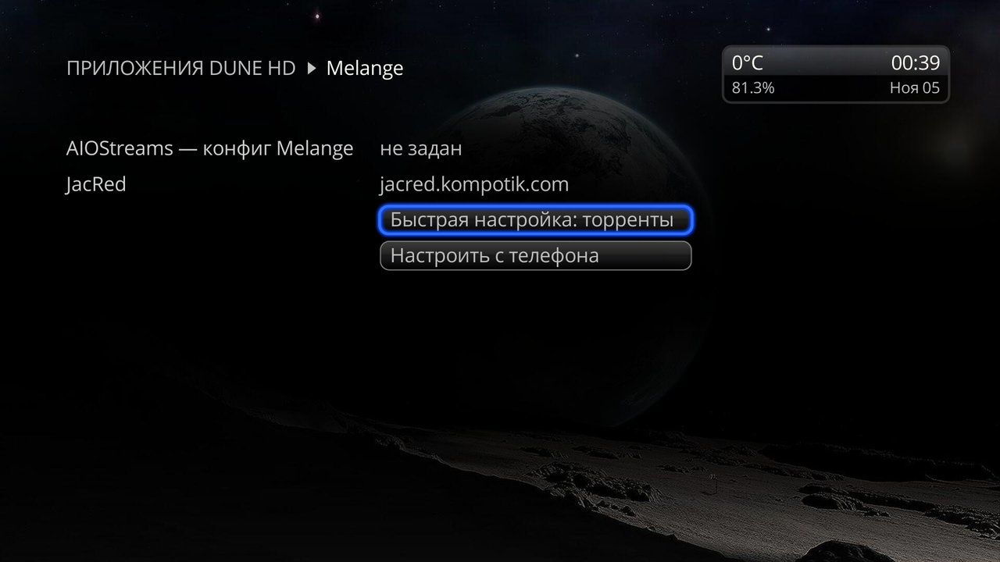
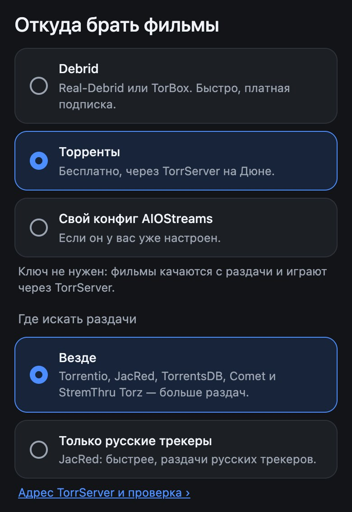
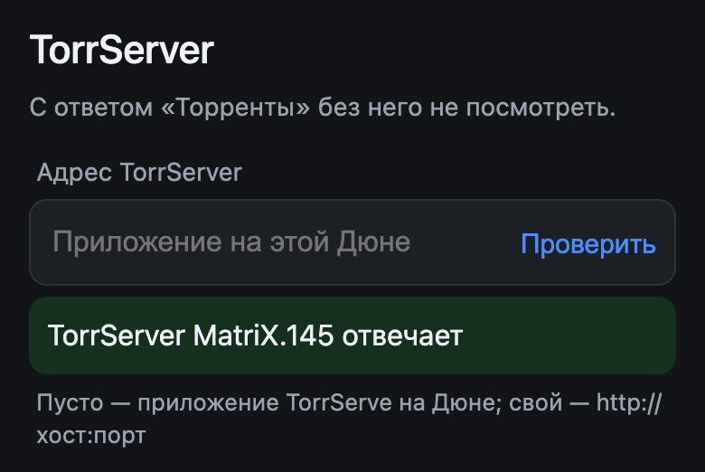
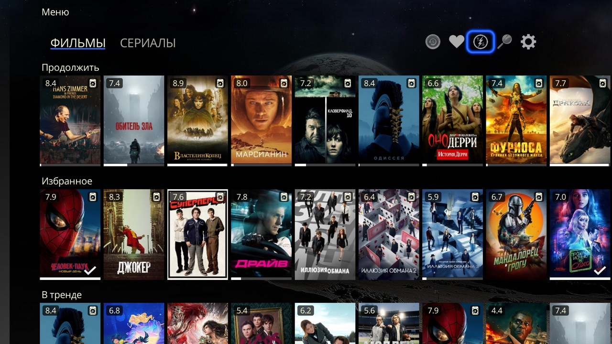
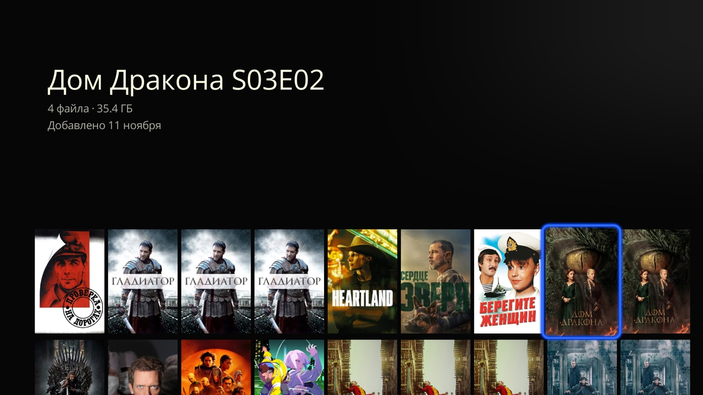
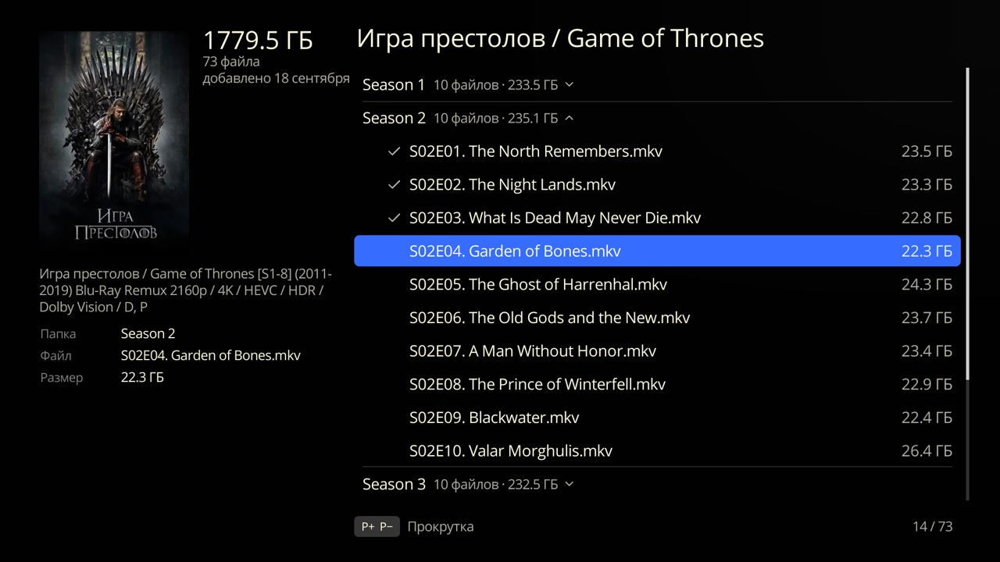
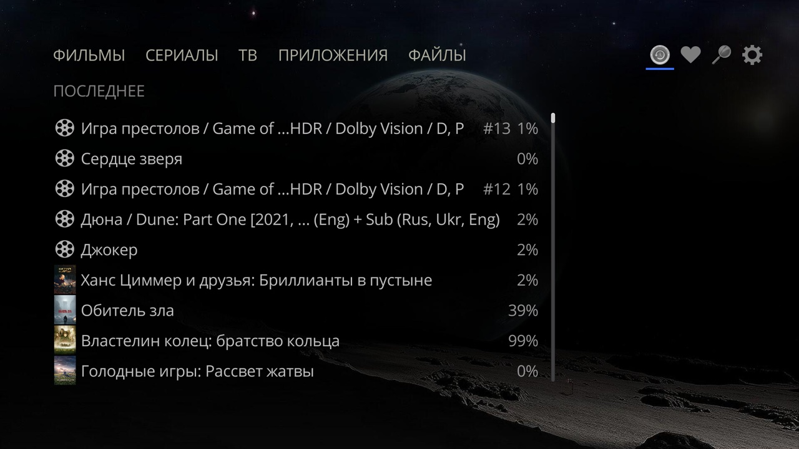

# Torrents and TorrServer

Set up torrent watching without a Debrid subscription. [← Contents](README.en.md)

You need: the TorrServe app on the Dune ([Quick start](start.en.md)).

1. Without a phone: open the plugin settings (the gear on the bar at the top) and choose "Quick setup: torrents". The Melange catalog opens: torrents are set up. If that's enough, go to step 5; if you have set Melange up before, start from step 2.

   

2. From a phone ([Settings page on a phone](phone-page.en.md)): open "Where to get films" and choose "Torrents". In "Where to look for releases", leave "Russian trackers only" (the default). If there are few releases, choose "Everywhere".

   

3. Press "TorrServer address and check ›". An empty field means Melange uses the TorrServe app on this Dune. Press "Check": a green line "TorrServer … is responding" should appear.

   

4. In "What to do with a release", leave "Play" and press "Save". "Saved. The Dune picks up the settings automatically." appears.

   

5. Open a movie on the Dune. The first column of the release list shows seeders (people sharing it); a release with more seeders starts faster.

   

## Torrents on TorrServer

Torrents already on TorrServer (added from a phone via NUM, KinoTrend, Lampa, or from Melange with "Add & Play") can be watched from Melange.

1. On the Movies or Series tab, open "On TorrServer" (the grey circle with a lightning bolt on the top bar, after the heart) or choose it in **POP UP**.

   

2. The screen lists all TorrServer torrents, newest first. Each line shows an icon and the name. On the right is the poster of the selected torrent, with the number of files, the size, the date added and the full name under it.

   

3. A movie: press **ENTER** and the player starts.

4. A series or a pack: press **ENTER** and choose a file. The cursor is already on the next unwatched episode; watched ones have a check mark. Episodes then play in order (**P+**/**P−**).

   

5. Next time the player offers "Continue" by itself. The torrent also shows up in "Recent" on the Dune home screen.

   

To remove a torrent from TorrServer, press **POP UP** on it in the list, choose "Remove from TorrServer" and confirm.

## On TorrServer row

These torrents can also sit in a catalog row, newest on the left. The row is the same on Movies and Series and is also in the TV tab.

1. Turn the row on: check "On TorrServer" in "Group order" on the Dune or in "Catalog rows" on the phone ([Your own catalog rows](catalog-rows.en.md)). It goes after Favorites, at once or the next time you open the catalog.

   <!-- frame: Group order, focus on On TorrServer with (x) -->

2. Press **ENTER** on a tile: a movie starts, a pack opens its list of files, as in the On TorrServer section. Torrents that Melange started show a poster with a rating, and the panel shows "On TorrServer", the number of files, the size and the date. Others show the torrent name.

   <!-- frame: catalog, On TorrServer row, focus on a tile with a poster, the "On TorrServer · …" line in the panel -->

3. To remove a torrent, press **POP UP** on the tile and choose "Remove from TorrServer". **ENTER** on the row name opens the whole section.

The row refreshes by itself a couple of seconds after the catalog opens or the next time you open it. It is not there if TorrServer is not set up, "No torrents" is chosen, or TorrServer is empty.

## If it didn't work

- "On TorrServer" says "TorrServer is not responding": start TorrServer or fix the address in Melange settings → TorrServer ("Retry" and "Settings" are on the same screen).
- After quick setup the Dune says "TorrServer does not answer": install and start TorrServe ([Quick start](start.en.md)).
- "Check" shows red text: see [Troubleshooting](troubleshooting.en.md).
- Few releases: choose "Everywhere" in "Where to look for releases"; if the JacRed server doesn't answer, see [JacRed](jacred.en.md).

Next: [JacRed](jacred.en.md) · [Contents](README.en.md)
