# Торренты и TorrServer

Настроим просмотр торрентов без подписки Debrid. [← Оглавление](README.md)

Нужно заранее: приложение TorrServe на Дюне ([Быстрый старт](start.md)).

1. Без телефона: откройте настройки плагина (шестерёнка на полосе сверху) и выберите «Быстрая настройка: торренты». Откроется каталог Melange: торренты настроены. Если этого хватило, переходите к шагу 5; если Melange уже настраивали, начните с шага 2.

   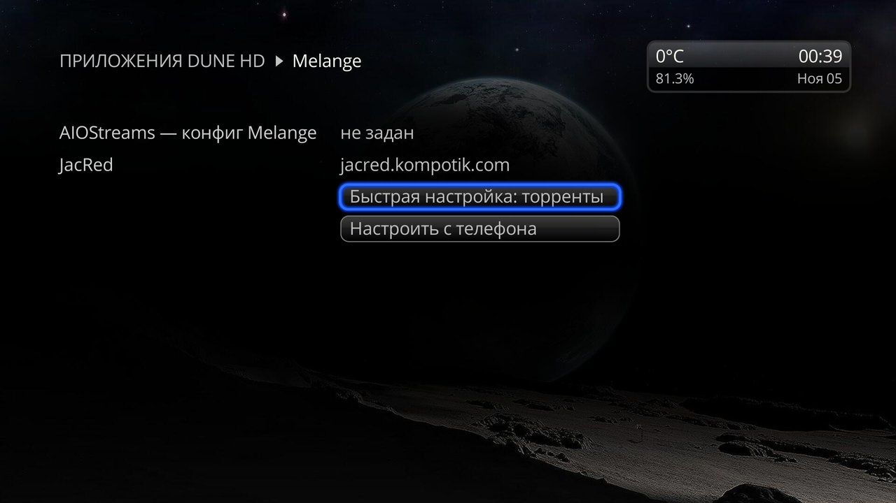

2. С телефона ([Страница настроек с телефона](phone-page.md)): откройте «Откуда брать фильмы» и выберите «Торренты». В «Где искать раздачи» оставьте «Только русские трекеры» (по умолчанию). Если раздач мало, выберите «Везде».

   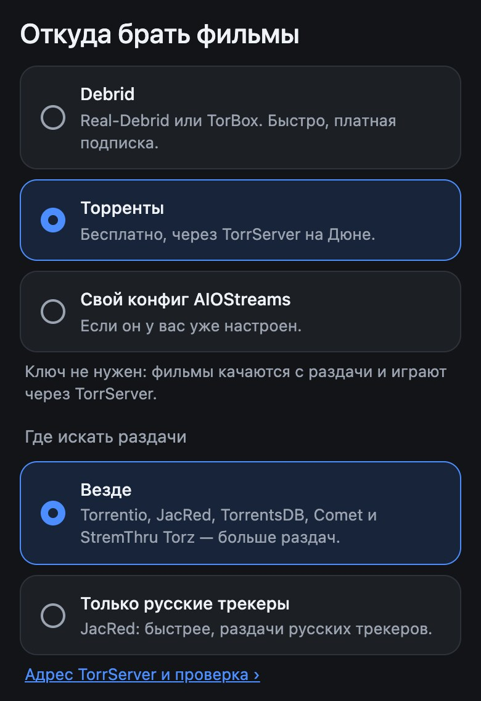

3. Нажмите «Адрес TorrServer и проверка ›». Пустое поле значит, что Melange берёт приложение TorrServe на этой Дюне. Нажмите «Проверить»: должна появиться зелёная строка «TorrServer … отвечает».

   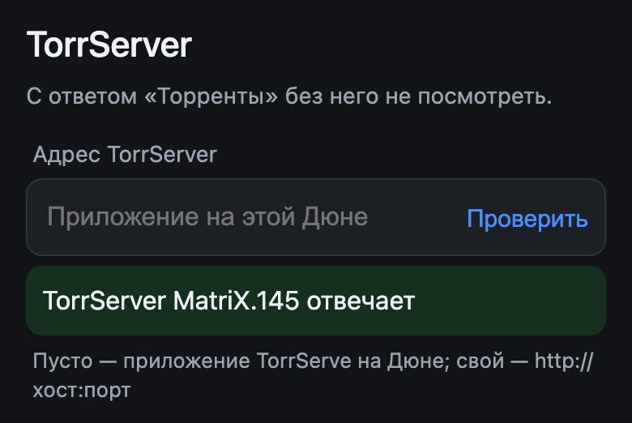

4. В «Что делать с раздачей» оставьте «Играть» и нажмите «Сохранить». Появится «Сохранено. Дюна подхватит настройки сама.»

   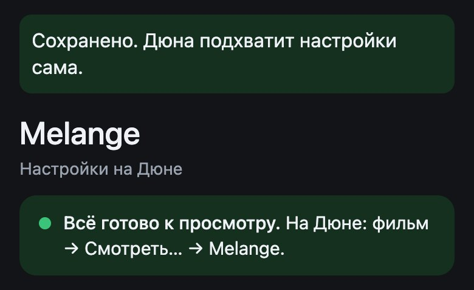

5. Откройте фильм на Дюне. В списке раздач в первой колонке видны сиды (раздающие); раздача с большим числом сидов включится быстрее.

   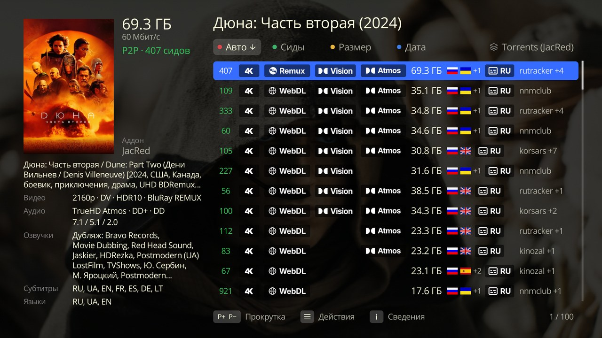

## Раздачи с TorrServer

Раздачи, которые уже есть на TorrServer (добавленные с телефона через NUM, KinoTrend, Lampa или из Melange в режиме «Добавить и играть»), можно смотреть из Melange.

1. На вкладке «Фильмы» или «Сериалы» откройте раздел «На TorrServer» (серый круг с молнией на полосе сверху, после сердечка) или выберите его в **POP UP**.

   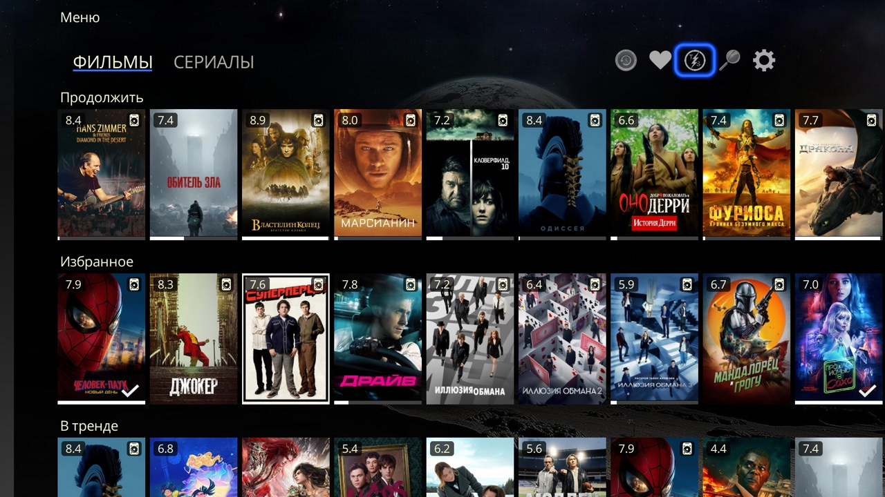

2. На экране все раздачи TorrServer списком, свежие сверху, в строке значок и название. Справа постер выделенной раздачи, под ним число файлов, размер, дата добавления и полное имя.

   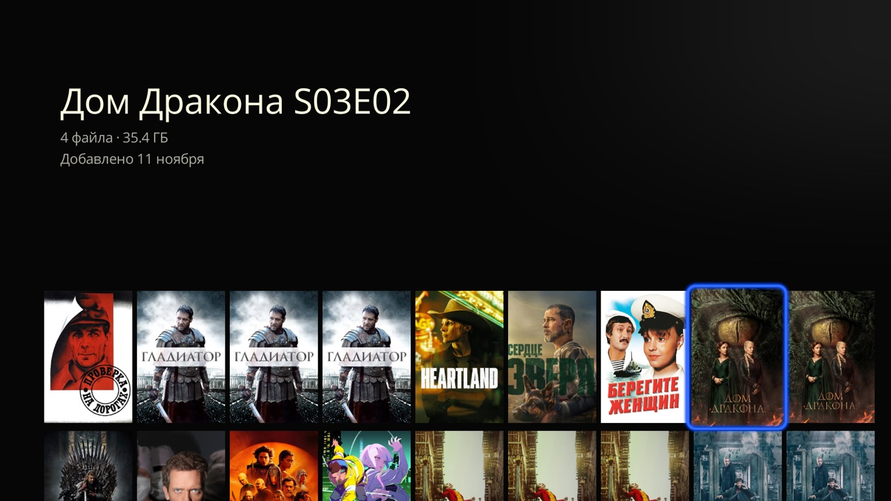

3. Фильм: нажмите **ENTER**, запустится плеер.

4. Сериал или пак: нажмите **ENTER** и выберите файл. Курсор уже стоит на следующей непросмотренной серии, просмотренные отмечены галочкой. Дальше серии идут по порядку (**P+**/**P−**).

   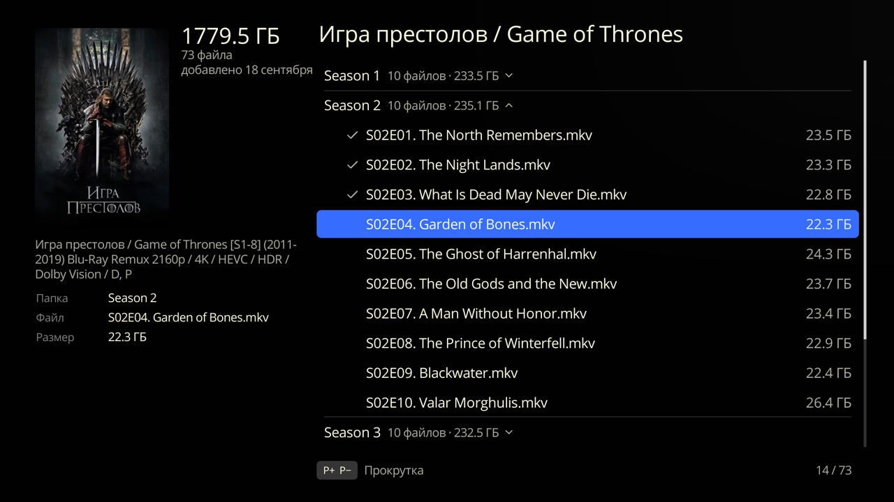

5. В следующий раз плеер сам предложит «Продолжить». Раздача появится и в «Последнем» на главном экране Дюны.

   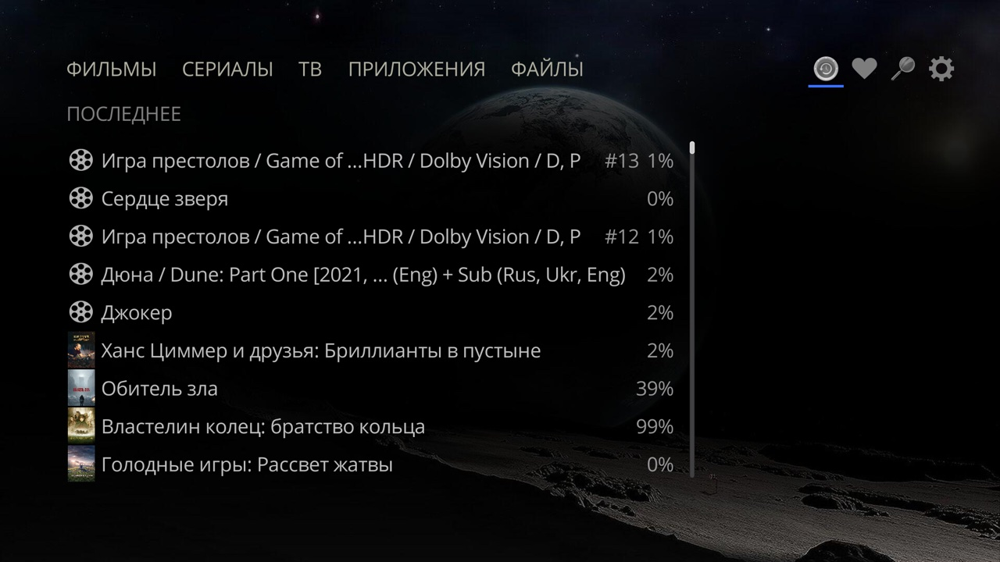

Чтобы удалить раздачу с TorrServer, нажмите **POP UP** на ней в списке, выберите «Удалить с TorrServer» и подтвердите.

## Ряд «На TorrServer»

Эти раздачи можно вывести рядом в каталоге, свежие слева. Ряд один и тот же на «Фильмах» и «Сериалах» и есть во вкладке «ТВ».

1. Включите ряд: отметьте «На TorrServer» в «Порядке групп» на Дюне или в «Рядах каталога» с телефона ([Свои ряды каталога](catalog-rows.md)). Он встанет после «Избранного» сразу или при следующем открытии каталога.

   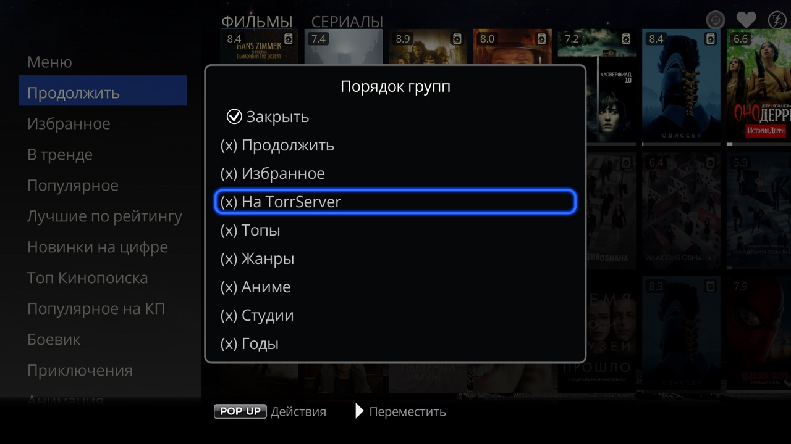

2. Нажмите **ENTER** на плитке: фильм включится, у пака откроется список файлов, как в разделе «На TorrServer». Раздачи, которые запускал Melange, показаны постером с рейтингом, в панели — число файлов, размер и дата. Остальные — названием раздачи.

   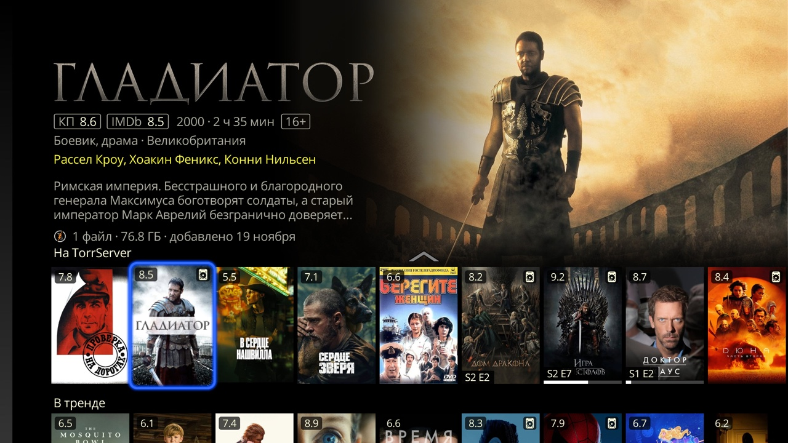

3. Чтобы удалить раздачу, нажмите **POP UP** на плитке и выберите «Удалить с TorrServer». **ENTER** на названии ряда открывает весь раздел.

Ряд обновляется сам: через пару секунд после открытия каталога или при следующем его открытии. Его нет, если TorrServer не настроен, выбрано «Без торрентов» или на TorrServer пусто.

## Если не получилось

- В разделе «На TorrServer» «TorrServer не отвечает» — запустите TorrServer или поправьте адрес в настройках Melange → TorrServer («Повторить» и «Настройки» есть на том же экране).
- После быстрой настройки Дюна пишет «TorrServer не отвечает» — установите и запустите TorrServe ([Быстрый старт](start.md)).
- «Проверить» пишет красным — см. [Решение проблем](troubleshooting.md).
- Раздач мало — выберите «Везде» в «Где искать раздачи»; если сервер JacRed не отвечает — [JacRed](jacred.md).

Дальше: [JacRed](jacred.md) · [Оглавление](README.md)
