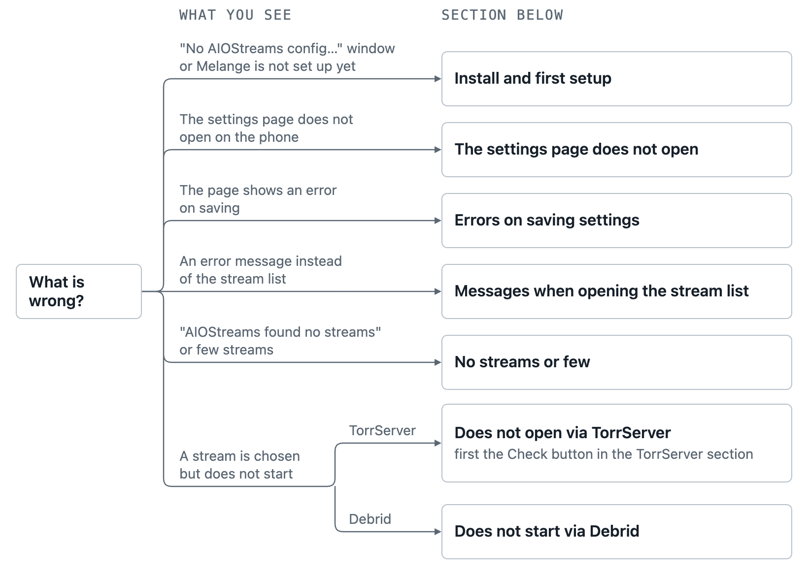
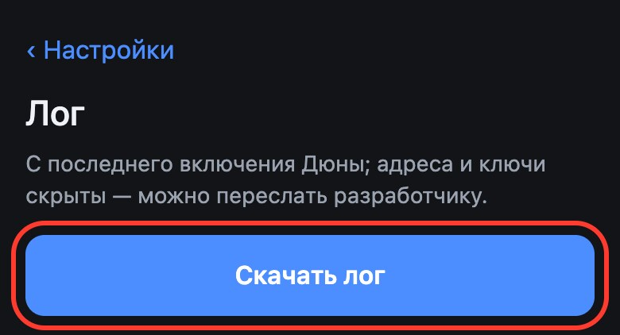

# Troubleshooting

A message or symptom and what to do. [← Contents](README.en.md)

- [Install and first setup](#install-and-first-setup)
- [The settings page does not open](#the-settings-page-does-not-open)
- [Errors when saving settings](#errors-when-saving-settings)
- [Messages when opening the release list](#messages-when-opening-the-release-list)
- [No releases or few](#no-releases-or-few)
- [Does not open via TorrServer](#does-not-open-via-torrserver)
- [Does not start via Debrid](#does-not-start-via-debrid)
- [Your own torrent client](#your-own-torrent-client)
- [Sources](#sources)
- [Catalog and the TV tab](#catalog-and-the-tv-tab)
- [Log](#log)
- [Where to write](#where-to-write)

## Install and first setup

On the Dune:

| Message or symptom | What to do |
|---|---|
| Window "No AIOStreams config — open Melange settings" in a movie card, torrents | Melange is not set up yet. **"Quick setup: torrents"** sets up torrents right away |
| The same window, Debrid | the settings did not reach the server. **"Set up"** opens the screen with the QR code: save the settings on the page again |
| "No AIOStreams config: Setup → Apps → Melange" | the same: open the settings by this path ([Settings page on a phone](phone-page.en.md)) |
| "The Melange server does not answer: check the Dune's internet" | check the internet and try again |
| "The Melange server is busy: try again in a minute" | try again in a minute |
| "The Melange server did not create the config" | try again in a minute; if that fails, set up from a phone ([Settings page on a phone](phone-page.en.md)) |
| "The config was created but not saved on the Dune", "The Melange settings file cannot be read: set up from a phone" | set up from a phone; if it happens again, send the [log](#log) |
| "TorrServer does not answer. The catalog and search work; to watch, install and start the TorrServe app on the Dune" | Melange is set up, but torrents will not play until TorrServe is running ([Torrents and TorrServer](torrserver.en.md)) |
| "TorrServe Silo is not supported: install TorrServe MatriX" | Melange is set up, but torrents will not play with TorrServe Silo: install TorrServe MatriX ([Quick start](start.en.md#manually)) |
| "The Dune's network IP address was not found" | the Dune is not on the network: check its connection to the router |

## The settings page does not open

- **The bookmark stopped opening.** Most likely the Dune's address on your home network changed. Open the Melange settings on the Dune, scan the QR code again ("Set up from a phone") and update the bookmark.
- **It does not open at all.** The phone must be on the same home network as the Dune: the page does not open over mobile internet.
- **After "Change the link"** old bookmarks do not work: scan the new QR code.
- **After "Load from a file"** the page opens by the link from the file: on the same Dune the old bookmark works again, on another one add the bookmark again ([Backup](backup.en.md)).

## Errors when saving settings

The error shows above the save button and next to the field.

| Message | What to do |
|---|---|
| "An address like https://…/manifest.json is needed: copy the config link from AIOStreams" | the link to your own config must end in `manifest.json`. Copy the whole link from AIOStreams |
| "… an address like http(s)://host[:port] is needed; the key - 8-200 characters without spaces, & and #" (own JacRed) | the address of your own JacRed must have no path or parameters, only the host and port. The key goes in its own field |
| "Own JacRed: with "Torrents", the key must not contain \|" | change the key of your own JacRed ([Known limitations](limitations.en.md#jacred)) |
| "Debrid needs a Real-Debrid or TorBox key; without one, choose "Torrents"" | enter the key or choose "Torrents" ([Debrid](debrid.en.md)) |
| "Real-Debrid: the key is not accepted (HTTP …)", "TorBox: the key is not accepted …" | the key was not copied in full or is out of date. Get it again on the service's site |
| "… the key is valid, but no premium" | without a subscription Debrid gives no releases: renew it |
| "server … request limit reached, try again in a minute" | the settings are saved, but the config on the AIOStreams server was not updated. Save again in a minute |
| "… answered: …" with text about a password, with your own AIOStreams server | your server asks for a password to create configs, and Melange does not send it. Allow creating configs without a password on the server, or create the config yourself and choose "Own config" ([AIOStreams and your own config](aiostreams.en.md)) |
| "… the server certificate is not accepted (self-signed?): try http://" | your own AIOStreams server has a self-signed certificate: use an address with `http://` |
| "Server … does not recognize the config (deleted there or password changed?): Melange has forgotten it; …" | press the button named in the message, and Melange creates a new config |

If the AIOStreams server did not answer, save again later: the other settings are already saved.

**The link to your own config stopped working** after the config password was changed in AIOStreams: paste the new link.

## Messages when opening the release list

On the Dune, when opening a movie:

| Message | What to do |
|---|---|
| "AIOStreams found no streams" | this movie has no releases at all, not even unconfirmed ones. If this happens with every movie, see [No releases or few](#no-releases-or-few) |
| "The link to your own AIOStreams config is not set", "Set the config link: Setup → Apps → Melange" | your own config is selected, but there is no link: paste it in "Where to get films" ([Settings page on a phone](phone-page.en.md)) |
| "AIOStreams is not responding", "AIOStreams returned an error", "Unexpected reply from AIOStreams" | a server or network failure: try again later. Details are in the [log](#log) |
| "Addons returned errors" | the AIOStreams addons did not answer. Try again later; the "Addon errors" setting shows what happened ([Advanced](advanced-options.en.md)) |
| "Reply too large: lower the result limit in the AIOStreams settings" | the server reply is over 6 MB. Lower the result limit in the web settings of the config ([AIOStreams and your own config](aiostreams.en.md)) |
| "No IMDb or TMDB ID: no releases" | the title has neither an IMDb ID nor a TMDB id, and releases are found only by them. If Lampac is among your [sources](profiles.en.md), the movie opens there. Lampac searches by title and year, so the list may include other movies with the same title ([Known limitations](limitations.en.md)) |
| "This title has no IMDb ID" | the title has neither an IMDb ID nor a TMDB id: Melange cannot find it ([Known limitations](limitations.en.md)) |
| "Releases cannot be found: no Dune card, IMDb or TMDB ID" | the movie has no Dune card, and its poster has neither an IMDb ID nor a TMDB id: Melange cannot find releases for it ([Known limitations](limitations.en.md)) |
| "The list is outdated, open it again", "This screen is outdated: open the catalog again" | open the movie or the catalog again |

To look into an error, move to a release and press **INFO**: after the release details, P+ / P− show everything the server sent. If your remote has no colour buttons or INFO, turn on "Remote without colour buttons" ([Advanced](advanced-options.en.md)).

## No releases or few

- **"AIOStreams found no streams" for every movie.** A common cause is that JacRed did not answer: then there are fewer releases, and with the "Russian trackers only" template none at all. Check whether JacRed answers ([JacRed](jacred.en.md)). The default is the Melange server `jacred.kompotik.com`; choose another one only if it does not answer.
- **Releases in the "Unconfirmed" group.** On the tracker their year, title or release date does not match the movie card. The group is the first row of the list and opens with **ENTER**. The release card on the left shows why in its "Check" line.
- **Few releases.** In "Where to look for releases", choose **"Everywhere"**: "Russian trackers only" gives fewer releases, especially with Real-Debrid alone.
- **The page says "jacred.stream refuses the chosen AIOStreams server: choose another JacRed".** Choose another JacRed.
- **Few series releases on a server marked "no TMDB".** Set your own TMDB key ([AIOStreams and your own config](aiostreams.en.md)).
- **Why the addons sent no releases** is shown by the "Addon errors" setting: turn it on ([Advanced](advanced-options.en.md)), then in the release list press POP UP → "Addon errors".

## Does not open via TorrServer

First press **"Check"** in the "TorrServer" section of the settings page ([Torrents and TorrServer](torrserver.en.md)).

| "Check" answer | What to do |
|---|---|
| "TorrServer … is responding" | all is well |
| "No answer: connection refused: install and start the TorrServe app on the Dune" | start TorrServe on the Dune (or install it) |
| "No answer: connection refused: TorrServer is not running at this address" | TorrServer on another device is not running, or the address is wrong |
| "No answer within 3 s", "No answer" | check the address and that the device with TorrServer is on |
| "It answered HTTP …: not a TorrServer?" | another program is at this address: check the port |
| "Not a TorrServer MatriX (an old 1.1?)" | update TorrServer to MatriX |
| "TorrServe Silo is not supported: install TorrServe MatriX" | TorrServe Silo answers at this address, and Melange does not work with it: install TorrServe MatriX ([Quick start](start.en.md#manually)) |
| "TorrServer asks for a login and password" | enter them in "Login" and "Password" |
| "TorrServer did not accept the login or password" | check the login and password |
| "TorrServer … is responding, but /settings: …" | TorrServer works, but its settings could not be read; you can still watch |

Messages on the Dune when starting playback:

| Message | What to do |
|---|---|
| "TorrServer is not responding", and below it "Start the TorrServe app on the Dune or check the address in the Melange settings: …" | start TorrServe |
| "TorrServer asks for a login and password…", "TorrServer did not accept the login or password…" | set or check them in the Melange settings → TorrServer |
| "No file list within a minute: the release has few seeders", "No file list, TorrServer closed the release: few seeders" | choose a release with more seeders |
| "The release has no file for this episode", "The release has no video" | choose another release |
| "TorrServer did not accept the release", "The reply is not from TorrServer MatriX" | check TorrServer with the "Check" button |
| "TorrServe Silo is not supported: install TorrServe MatriX" (the "On TorrServer" section says the same) | install TorrServe MatriX ([Quick start](start.en.md#manually)) |
| "Torrents are disabled in the settings" | the "No torrents" setting is on ([Advanced](advanced-options.en.md)) |

**Episodes take long to start**: turn off "Skip intro and credits" ([Advanced](advanced-options.en.md)).

## Does not start via Debrid

On the Dune, when starting a release:

| Message | What to do |
|---|---|
| "Debrid has not downloaded the release yet, try again later" | the release is downloading in Debrid: try again later |
| "Debrid gave an archive, not a video — pick another release" | the release is a RAR or ZIP archive, and the Dune does not play it: choose another one |
| "Debrid blocked the release: copyright", "Debrid found no matching file in the release — pick another", "Debrid didn't return the video — pick another release" | choose another release |
| "Debrid limit reached" | the account limit is used up: wait or choose another release |
| "Debrid is temporarily unavailable — try again later" | the failure is on the Debrid side: try again in a few minutes or choose another release |
| "Debrid rejected the key — check it and the subscription" | check the Debrid key in the Melange settings ([Debrid](debrid.en.md)) and whether the subscription is still active; with your own config, the key is set in AIOStreams |
| "… could not play the release" and a "Play via TorBox" (or "Play via Real-Debrid") button | the release is cached in both services: press the button, and it starts through the other one |
| The "Another release" button | the list has another release with the same file, cached on Debrid: press the button to start it |

**Real-Debrid refuses "Not cached" releases**: do not start such releases more than 1–2 times in a row, wait a few minutes ([Known limitations](limitations.en.md#debrid)).

## Your own torrent client

Answers of the **"Check"** button of a server on the settings page ([Your own torrent client](download-server.en.md)):

| Answer | What to do |
|---|---|
| "OK: logged in · version …" or "OK: no login · …" | all is well |
| "No category …: qBittorrent will create it on the first download…", "No tag …" | nothing: it gets created by itself |
| "Wrong login or password" | check the login and password |
| "The server requires a login: fill in the login and password" | enter the login and password |
| "qBittorrent has banned the Dune for a while after failed logins: wait (up to an hour by default)" | after several wrong passwords in a row (5 by default) qBittorrent blocks the Dune, and downloads with it. Wait, then fix the password |
| "The server does not let the Dune in: add its address to the Transmission whitelist (rpc-whitelist)" | add the Dune's address to `rpc-whitelist` in the Transmission settings |
| "Transmission does not accept the server name of the address: use an IP or add the name to rpc-host-whitelist" | use the IP address or add the name to `rpc-host-whitelist` |
| "Labels are kept since Transmission 4.0: this server will skip them" | on Transmission older than 4.0 tags are not kept, everything else works |
| "The reply does not look like qBittorrent", "The reply does not look like Transmission (HTTP …): check the address", "Login: HTTP …: not a qBittorrent?" | wrong address or the wrong client is selected |
| "The reply does not look like Synology Download Station (…): check the address" | wrong address, the wrong client is selected, or Download Station is not installed on the NAS |
| "The user has no access to Download Station: allow it in DSM (Control Panel → Application Privileges)" | in DSM open Control Panel → Application Privileges and allow Download Station for this user |
| "The user has 2-step verification on: create a separate DSM user without it" | create a separate DSM user without 2-step verification and enter its login and password |
| "Synology has blocked the address of the Dune after wrong passwords (auto block in DSM)" | after several wrong passwords in a row DSM keeps the Dune out even with the right one. Unblock the Dune's address in DSM and fix the password |
| under "OK: logged in · version …" a second line "Download Station has no default folder set: downloads will wait" | downloads get added but stay waiting. Open Download Station as this user and set the default folder: each DSM user has their own |

Messages on the Dune after POP UP → "Download to server":

- "No connection to the server": check that the server is on.
- "The client did not accept the torrent (it may already have it)": look in the client.
- "The server did not answer in time — check the client": the release may have been added, look in the client.
- "No download folder set: set it in the server settings or in Download Station": enter a folder in the server block on the settings page or set the default folder in Download Station.
- "No such folder on the Synology: enter "shared folder/subfolder"": the folder must already exist on the NAS. Enter it as "shared folder/subfolder", for example `video/Torrents`.
- The messages about access to Download Station, 2-step verification and the blocked address are the same as for "Check", see the table above.

## Sources

On the settings page:

| Message or symptom | What to do |
|---|---|
| A source is marked "no config" and is missing from the "Source" panel on the Dune | the source config was not created on the server (for example, the server did not answer). Open the source on the page and press "Save" |
| "A source "…" exists already, choose another name" | change the name |
| "There are 8 sources already. Delete one to add another." | delete a source you do not need |
| "The source was deleted in another tab: reload the page" | reload the page |

On the Dune:

| Message | What to do |
|---|---|
| "Source not changed: …" | the source did not answer. Try again later or choose another one |
| "Sources changed on the page, the source is kept" | the source was changed on the page while the panel was open: open "Source" again |

## Catalog and the TV tab

- **"The Dune firmware does not support this dialog"** on "Configure List...": set up the rows from a phone ([Your own catalog rows](catalog-rows.en.md)).
- **Row names in the catalog cannot be selected**: the "Navigation panel on the left" is turned off in the Dune settings. Turn it on or set up the rows from a phone.
- **"The catalog did not load. Check the network and retry"**, **"Search failed: the server does not answer. Try later"**: check the internet and try again.
- **The microphone button on the remote starts Google Assistant**: open search with the magnifier on the top bar or via **POP UP** → "Search" ([Search](search.en.md)).
- **The TV tab is empty.** Most likely Melange was removed while it was chosen for TV. On the home screen, move to TV, press **POP UP** → «TV section Setup» and choose your previous TV app (for example, DUNE-HD.TV), or Melange again if you reinstalled it ([Melange in the TV tab](tv-tab.en.md)).
- **TV has a single "Set up Melange" tile**: Melange is not set up yet. Press it ([Quick start](start.en.md)).
- **"Open in an app" always opens the same app**: "Always" was once chosen in the Android window. Clear the default choice in the Android settings of that app.

## Log

The log shows what went wrong; attach it to an Issue.

On the main screen of the settings page, open **"Log"** and press **"Download the log"**. Download it **before** rebooting the Dune: after a reboot the log starts over.

**What is in the log:** the Melange version, the Dune model and firmware, the selected AIOStreams, JacRed and TorrServer servers, what Melange did since the Dune was last switched on (which movies were opened, how many releases came, errors) and the end of the Dune shell log.

**What is hidden:** the serial number, MAC and IP addresses, names of computers on your home network, keys, passwords, tokens, the addresses of AIOStreams configs and of your own servers (JacRed, AIOStreams, TorrServer, torrent clients), playback links with Debrid tokens. Other links keep only the server.

Before sending, look the file over: it has the titles of the movies and episodes you opened, and the shell log also has the names of your favorites shortcuts, the list of installed plugins and apps, and catalog movie IDs.

## Where to write

- Bugs: open an Issue on GitHub: https://github.com/a1d4r/dune-hd-melange/issues. Describe what you did and what went wrong, and attach the log.

Next: [Known limitations](limitations.en.md) · [Contents](README.en.md)
