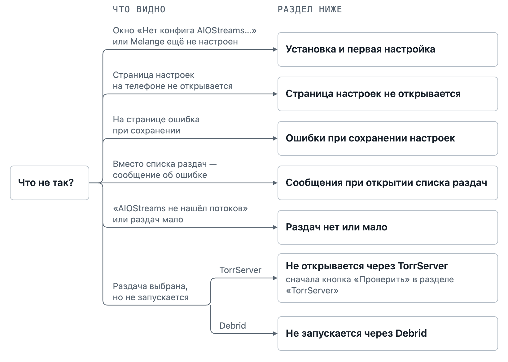
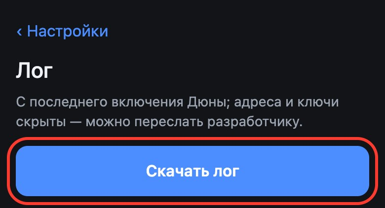

# Решение проблем

Сообщение или симптом и что сделать. [← Оглавление](README.md)

- [Установка и первая настройка](#установка-и-первая-настройка)
- [Страница настроек не открывается](#страница-настроек-не-открывается)
- [Ошибки при сохранении настроек](#ошибки-при-сохранении-настроек)
- [Сообщения при открытии списка раздач](#сообщения-при-открытии-списка-раздач)
- [Раздач нет или мало](#раздач-нет-или-мало)
- [Не открывается через TorrServer](#не-открывается-через-torrserver)
- [Не запускается через Debrid](#не-запускается-через-debrid)
- [Свой торрент-клиент](#свой-торрент-клиент)
- [Профили источников](#профили-источников)
- [Каталог и вкладка «ТВ»](#каталог-и-вкладка-тв)
- [Лог](#лог)
- [Куда писать](#куда-писать)

## Установка и первая настройка

На Дюне:

| Сообщение или симптом | Что сделать |
|---|---|
| Окно «Нет конфига AIOStreams — откройте настройки Melange» в карточке фильма, торренты | Melange ещё не настроен. **«Быстрая настройка: торренты»** настроит торренты сразу |
| То же окно, Debrid | настройки не дошли до сервера. **«Настроить»** откроет экран с QR-кодом: на странице сохраните настройки ещё раз |
| «Нет конфига AIOStreams: Настройки → Приложения → Melange» | то же: откройте настройки по этому пути ([Страница настроек с телефона](phone-page.md)) |
| «Сервер Melange не отвечает — проверьте интернет на Дюне» | проверьте интернет и повторите |
| «Сервер Melange занят — повторите через минуту» | повторите через минуту |
| «Сервер Melange не создал конфиг» | повторите через минуту; не вышло — настройте с телефона ([Страница настроек с телефона](phone-page.md)) |
| «Конфиг создан, но не записан на Дюне», «Файл настроек Melange не читается — настройте с телефона» | настройте с телефона; повторится — пришлите [лог](#лог) |
| «TorrServer не отвечает. Каталог и поиск работают, а для просмотра установите и запустите на Дюне приложение TorrServe» | Melange настроен, но торренты не включатся, пока не запущен TorrServe ([Торренты и TorrServer](torrserver.md)) |
| «Не найден IP-адрес Дюны в сети» | Дюна не в сети: проверьте подключение к роутеру |

## Страница настроек не открывается

- **Закладка перестала открываться.** Скорее всего, у Дюны в домашней сети сменился адрес. Откройте на Дюне настройки Melange, снова отсканируйте QR («Настроить с телефона») и обновите закладку.
- **Не открывается совсем.** Телефон должен быть в той же домашней сети, что и Дюна: через мобильный интернет страница не откроется.
- **После «Сменить ссылку»** старые закладки не работают: отсканируйте новый QR.
- **После «Загрузить из файла»** страница открывается по ссылке из файла: на той же Дюне старая закладка снова работает, на другой — добавьте закладку заново ([Резервная копия](backup.md)).

## Ошибки при сохранении настроек

Ошибка видна над кнопкой сохранения и у поля.

| Сообщение | Что сделать |
|---|---|
| «Нужен адрес вида https://…/manifest.json — скопируйте ссылку на конфиг из AIOStreams» | ссылка на свой конфиг должна кончаться на `manifest.json`. Скопируйте её из AIOStreams целиком |
| «… нужен адрес вида http(s)://хост[:порт]; ключ — 8–200 символов без пробелов, & и #» (свой JacRed) | в адресе своего JacRed не должно быть пути и параметров, только хост и порт. Ключ — в отдельное поле |
| «Свой JacRed: в режиме «Торренты» ключ — без символа \|» | смените ключ своего JacRed ([Известные ограничения](limitations.md#jacred)) |
| «Для Debrid нужен ключ Real-Debrid или TorBox; без ключа выберите «Торренты»» | введите ключ или выберите «Торренты» ([Debrid](debrid.md)) |
| «Real-Debrid: ключ не принят (HTTP …)», «TorBox: ключ не принят …» | ключ скопирован не целиком или устарел. Возьмите его заново на сайте сервиса |
| «… ключ верный, но премиума нет» | без подписки Debrid раздачи не отдаст: продлите её |
| «лимит запросов сервера …, повторите через минуту» | настройки сохранены, а конфиг на сервере AIOStreams не обновился. Сохраните ещё раз через минуту |
| «… ответил: …» с текстом про пароль, при своём сервере AIOStreams | ваш сервер просит пароль на создание конфигов, а Melange его не передаёт. Разрешите на сервере создание конфигов без пароля или создайте конфиг сами и выберите «Свой конфиг» ([AIOStreams и свой конфиг](aiostreams.md)) |
| «… сертификат сервера не принят (самоподписанный?) — попробуйте http://» | у своего сервера AIOStreams самоподписанный сертификат: укажите адрес с `http://` |
| «Сервер … не узнал конфиг (удалён на сервере или сменён пароль?) — Melange его забыл; …» | нажмите кнопку из сообщения, Melange создаст новый конфиг |

Если сервер AIOStreams не ответил, сохраните ещё раз позже: остальные настройки уже сохранены.

**Ссылка на свой конфиг перестала работать** после смены пароля конфига в AIOStreams — вставьте новую ссылку.

## Сообщения при открытии списка раздач

На Дюне, при открытии фильма:

| Сообщение | Что сделать |
|---|---|
| «AIOStreams не нашёл потоков» | раздач для этого фильма не нашлось. Если так у всех фильмов, см. [Раздач нет или мало](#раздач-нет-или-мало) |
| «Не задана ссылка на свой конфиг AIOStreams», «Задайте ссылку на конфиг: Настройки → Приложения → Melange» | выбран свой конфиг, а ссылки нет: вставьте её в «Откуда брать фильмы» ([Страница настроек с телефона](phone-page.md)) |
| «AIOStreams не отвечает», «AIOStreams вернул ошибку», «Непонятный ответ AIOStreams» | сбой сервера или сети: попробуйте позже. Подробности — в [логе](#лог) |
| «Источники вернули ошибки» | источники раздач не ответили. Попробуйте позже; что случилось, покажет настройка «Ошибки источников» ([Дополнительно](advanced-options.md)) |
| «Слишком большой ответ: уменьшите лимит результатов в настройках AIOStreams» | ответ сервера больше 6 МБ. Уменьшите лимит результатов в веб-настройках конфига ([AIOStreams и свой конфиг](aiostreams.md)) |
| «У фильма нет IMDb-id», «Раздачи не найти: нет карточки Дюны и IMDb-id» | без IMDb-id Melange фильм не найдёт ([Известные ограничения](limitations.md#фильмы-и-список-раздач)) |
| «Список устарел, откройте его заново», «Экран устарел: откройте каталог заново» | откройте фильм или каталог ещё раз |

Для разбора ошибки встаньте на раздачу и нажмите **INFO**: после сведений о раздаче по P+ / P− видно всё, что прислал сервер.

## Раздач нет или мало

- **«AIOStreams не нашёл потоков» у всех фильмов.** Частая причина — JacRed не ответил: тогда раздач меньше, а в шаблоне «Только русские трекеры» ни одной. Проверьте, отвечает ли JacRed ([JacRed](jacred.md)). По умолчанию выбран сервер Melange `jacred.kompotik.com`; другой выбирайте, только если он не отвечает.
- **Раздач мало.** В «Где искать раздачи» выберите **«Везде»**: «Только русские трекеры» даёт меньше раздач, особенно с одним Real-Debrid.
- **На странице «jacred.stream не пускает выбранный сервер AIOStreams — выберите другой JacRed».** Выберите другой JacRed.
- **Мало раздач сериалов на сервере с пометкой «без TMDB».** Задайте свой ключ TMDB ([AIOStreams и свой конфиг](aiostreams.md)).
- **Почему источники не прислали раздачи**, покажет настройка «Ошибки источников»: включите её ([Дополнительно](advanced-options.md)), затем в списке раздач POP UP → «Ошибки источников».

## Не открывается через TorrServer

Сначала нажмите **«Проверить»** в разделе «TorrServer» страницы настроек ([Торренты и TorrServer](torrserver.md)).

| Ответ «Проверить» | Что сделать |
|---|---|
| «TorrServer … отвечает» | всё в порядке |
| «Не отвечает: соединение отклонено — установите и запустите приложение TorrServe на Дюне» | запустите TorrServe на Дюне (или поставьте его) |
| «Не отвечает: соединение отклонено — TorrServer по этому адресу не запущен» | TorrServer на другом устройстве не запущен или адрес неверный |
| «Нет ответа за 3 с», «Не отвечает» | проверьте адрес и что устройство с TorrServer включено |
| «Ответил HTTP … — это не TorrServer?» | по этому адресу другая программа: проверьте порт |
| «Ответил не TorrServer MatriX (старый 1.1?)» | обновите TorrServer до MatriX |
| «TorrServer просит логин и пароль» | впишите их в «Логин» и «Пароль» |
| «TorrServer не принял логин или пароль» | проверьте логин и пароль |
| «TorrServer … отвечает, но /settings: …» | TorrServer работает, но его настройки не прочитались; смотреть можно |

Сообщения на Дюне при запуске:

| Сообщение | Что сделать |
|---|---|
| «TorrServer не отвечает: установите и запустите на Дюне приложение TorrServe или проверьте адрес в настройках Melange» | запустите TorrServe |
| «TorrServer просит логин и пароль…», «TorrServer не принял логин или пароль…» | задайте или проверьте их в настройках Melange → TorrServer |
| «За минуту нет списка файлов: у раздачи мало сидов», «Списка файлов нет, TorrServer закрыл раздачу: мало сидов» | выберите раздачу с большим числом сидов |
| «В раздаче нет файла этой серии», «В раздаче нет видео» | выберите другую раздачу |
| «TorrServer не принял раздачу», «Ответил не TorrServer MatriX» | проверьте TorrServer кнопкой «Проверить» |
| «Торренты отключены в настройках» | включена настройка «Без торрентов» ([Дополнительно](advanced-options.md)) |

**Серии долго запускаются** — выключите «Пропуск заставки и титров» ([Дополнительно](advanced-options.md)).

## Не запускается через Debrid

На Дюне, при запуске раздачи:

| Сообщение | Что сделать |
|---|---|
| «Debrid ещё не скачал раздачу, попробуйте позже» | раздача качается в Debrid: попробуйте позже |
| «Debrid отдал архив вместо видео — выберите другую раздачу» | раздача — архив RAR или ZIP, Дюна его не играет: выберите другую |
| «Debrid заблокировал раздачу: авторские права», «Debrid не нашёл в раздаче нужный файл — выберите другую», «Debrid не отдал видео — выберите другую раздачу» | выберите другую раздачу |
| «Лимит Debrid» | лимит аккаунта исчерпан: подождите или выберите другую раздачу |
| «… не запустил раздачу» и кнопка «Через TorBox» (или «Через Real-Debrid») | раздача есть в кэше обоих сервисов: нажмите кнопку, она запустится через другой |

**Real-Debrid отказывает в раздачах «Нужно скачать»** — не запускайте такие раздачи больше 1–2 раз подряд, подождите несколько минут ([Известные ограничения](limitations.md#debrid)).

## Свой торрент-клиент

Ответы кнопки **«Проверить»** у сервера на странице настроек ([Свой торрент-клиент](download-server.md)):

| Ответ | Что сделать |
|---|---|
| «OK: вход принят · версия …» или «OK: без входа · …» | всё в порядке |
| «Категории … нет — qBittorrent создаст её при первой закачке…», «Тега … нет…» | ничего: создастся само |
| «Неверный логин или пароль» | проверьте логин и пароль |
| «Сервер требует вход: укажите логин и пароль» | впишите логин и пароль |
| «qBittorrent временно заблокировал Дюну после неудачных входов — подождите (по умолчанию до часа)» | после нескольких неверных паролей подряд (по умолчанию 5) qBittorrent блокирует Дюну, а с ней и закачки. Подождите, затем исправьте пароль |
| «Сервер не пускает Дюну: добавьте её адрес в белый список Transmission (rpc-whitelist)» | добавьте адрес Дюны в `rpc-whitelist` в настройках Transmission |
| «Transmission не принимает имя сервера в адресе: укажите IP или добавьте имя в rpc-host-whitelist» | укажите адрес по IP или добавьте имя в `rpc-host-whitelist` |
| «Метки сохраняются с Transmission 4.0 — этот сервер их пропустит» | на Transmission старше 4.0 теги не сохранятся, остальное работает |
| «Ответ не похож на qBittorrent», «Ответ не похож на Transmission (HTTP …) — проверьте адрес», «Вход: ответ HTTP … — это не qBittorrent?» | неверный адрес или выбран не тот клиент |

Сообщения на Дюне после POP UP → «Скачать на сервер…»:

- «Нет связи с сервером» — проверьте, что сервер включён.
- «Клиент не принял раздачу (может быть, она там уже есть)» — посмотрите в клиенте.
- «Сервер не ответил вовремя — проверьте в клиенте» — раздача могла добавиться, посмотрите в клиенте.

## Профили источников

На странице настроек:

| Сообщение или симптом | Что сделать |
|---|---|
| У профиля пометка «конфига нет», его нет в меню POP UP на Дюне | конфиг профиля на сервере не создан (например, сервер не ответил). Откройте профиль на странице и нажмите «Сохранить» |
| «Конфига профиля ещё нет: нажмите «Сохранить»» | то же |
| «Такие настройки уже в профиле «…»» | двух одинаковых профилей не бывает: поменяйте хотя бы одну настройку |
| «Профиль «…» уже есть, выберите другое название» | смените название |
| «Профилей уже 8. Удалите лишний, чтобы добавить новый.» | удалите ненужный профиль |
| «Профили изменились в другой вкладке — обновите страницу» | обновите страницу |
| Страница показывает не тот текущий профиль | профиль переключили на Дюне: обновите страницу |

## Каталог и вкладка «ТВ»

- **«Прошивка Дюны не поддерживает этот диалог»** при «Настроить список...» — настройте ряды с телефона ([Свои ряды каталога](catalog-rows.md)).
- **Названия рядов в каталоге не выбираются** — в настройках Дюны выключена «Навигационная панель слева». Включите её или настройте ряды с телефона.
- **«Каталог не загрузился. Проверьте сеть и повторите»**, **«Поиск не удался: сервер не отвечает. Повторите позже»** — проверьте интернет и повторите.
- **Вкладка «ТВ» пустая.** Скорее всего, удалили Melange, а он был выбран для «ТВ». На главном экране встаньте на «ТВ», нажмите **POP UP** → «Настройка раздела ТВ» и выберите DUNE-HD.TV или снова Melange, если поставили его заново ([Melange во вкладке «ТВ»](tv-tab.md)).
- **В «ТВ» одна плитка «Настроить Melange»** — Melange ещё не настроен: нажмите её ([Быстрый старт](start.md)).
- **«Открыть в приложении…» всегда открывает одно и то же приложение** — в окне Android однажды выбрали «Всегда». Сбросьте выбор по умолчанию в настройках Android у этого приложения.

## Лог

Лог нужен, чтобы разобраться, что пошло не так, или приложить к Issue.

На главном экране страницы настроек откройте **«Лог»** и нажмите **«Скачать лог»**. Скачайте его **до** перезагрузки Дюны: после неё лог начинается заново.

**Что в логе:** версия Melange, модель и прошивка Дюны, выбранные серверы AIOStreams, JacRed и TorrServer, действия Melange с последнего включения Дюны (какие фильмы открывали, сколько пришло раздач, ошибки) и конец лога оболочки Дюны.

**Что скрыто:** серийный номер, MAC- и IP-адреса, имена компьютеров домашней сети, ключи, пароли, токены, адреса конфигов AIOStreams и своих серверов (JacRed, AIOStreams, TorrServer, торрент-клиентов), ссылки на воспроизведение с токенами Debrid. У остальных ссылок остаётся только сервер.

Перед отправкой просмотрите файл: в нём названия фильмов и серий, которые вы открывали, а в логе оболочки — ещё названия ярлыков избранного, список установленных плагинов и приложений и ID фильмов каталога.

## Куда писать

- Ошибка — Issue на GitHub: https://github.com/a1d4r/dune-hd-melange/issues. Опишите, что делали и что пошло не так, и приложите лог.

Дальше: [Известные ограничения](limitations.md) · [Оглавление](README.md)
