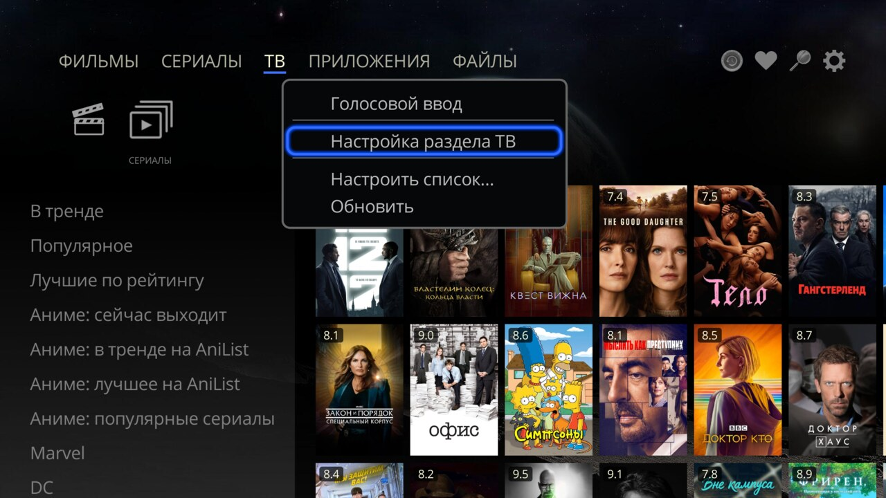
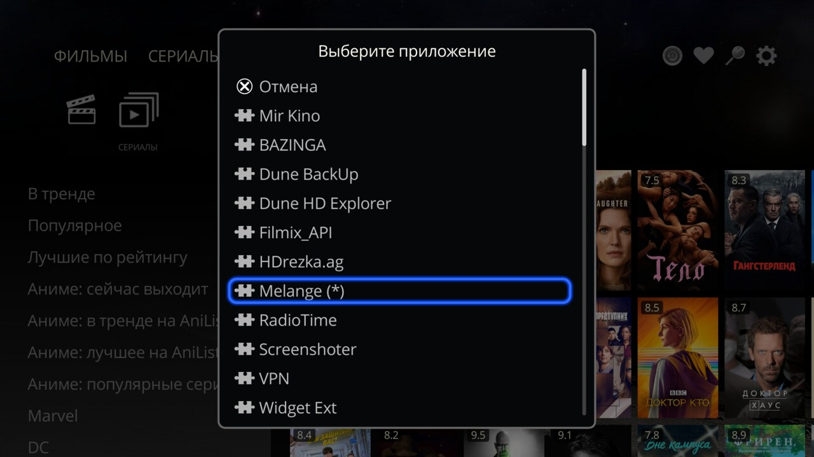
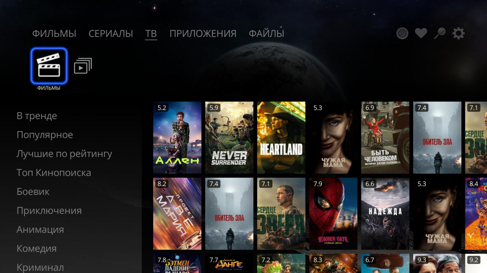
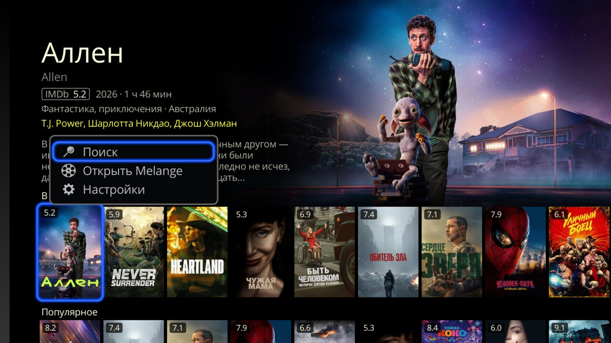

# Melange in the TV tab

Show Melange catalog rows right on the Dune home screen, in the TV tab. [← Contents](README.en.md)

1. On the Dune home screen, move to TV, press **POP UP** and choose «TV section Setup».

   In the picture Melange is already in TV; you will still have your TV channels there, and that is fine.

   

2. In the window, choose «Another application...»: a list of apps opens. Choose Melange. TV holds only one app, so your TV channels leave the tab. To bring them back, choose your previous app in the same window.

   

3. Under TV, the "Movies" and "Series" sub-items appear right away, with the catalog rows.

   

4. On a poster, press **POP UP**: it has the same items as in the catalog ([Continue Watching and Favorites](favorites.en.md)), plus Open Melange. On a row name the menu also has **Configure List...**. Rows you turn on there appear in TV usually a few seconds later.

   

## If it did not work

- TV has a single "Set up Melange" tile: Melange is not set up yet. Open it and go through the [Quick start](start.en.md).
- There are no "Movies" and "Series" sub-items, or the TV tab is empty after Melange was removed: see [Known limitations](limitations.en.md) and [Troubleshooting](troubleshooting.en.md).

Next: [Advanced](advanced-options.en.md) · [Contents](README.en.md)
