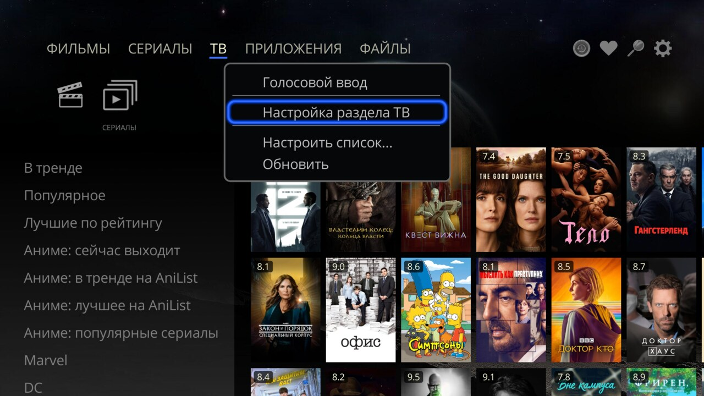
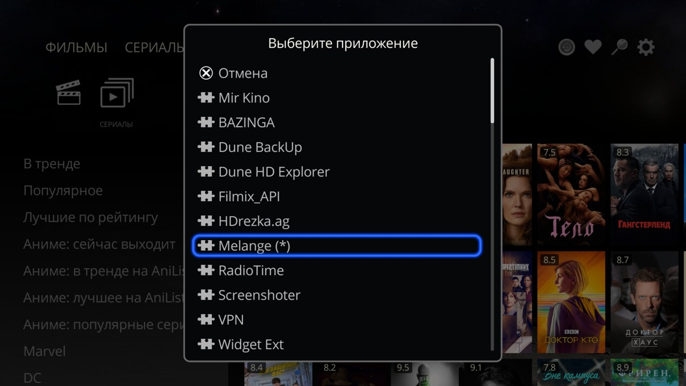
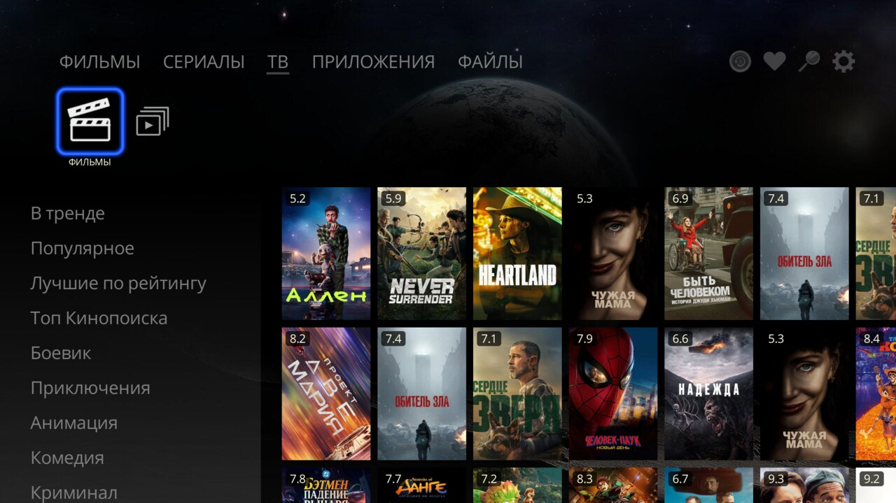
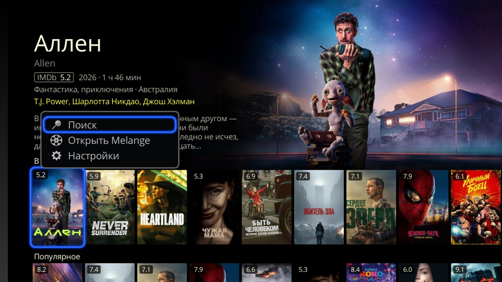

# Melange во вкладке «ТВ»

Выведем ряды каталога Melange прямо на главный экран Дюны, во вкладку «ТВ». [← Оглавление](README.md)

1. На главном экране Дюны встаньте на «ТВ», нажмите **POP UP** и выберите «Настройка раздела ТВ». То же есть в «Настройки → Приложения → ТВ → Настроить…».

   На кадре Melange уже во «ТВ»; у вас там пока каналы DUNE-HD.TV, так и должно быть.

   

2. В окне выберите «Другое приложение…»: откроется список приложений. Выберите Melange. Во «ТВ» помещается одно приложение, поэтому каналы DUNE-HD.TV из вкладки уйдут. Чтобы вернуть их, выберите DUNE-HD.TV в этом же окне.

   

3. Под «ТВ» сразу появятся подпункты «Фильмы» и «Сериалы» с рядами каталога. ENTER на постере открывает карточку фильма. Ряды обновляются сами, примерно раз в час.

   

4. На постере нажмите **POP UP**: там «Поиск», «Открыть Melange» и «Настройки».

   

## Если не получилось

- Во «ТВ» одна плитка «Настроить Melange» — Melange ещё не настроен, откройте её и пройдите [Быстрый старт](start.md).
- Подпунктов «Фильмы» и «Сериалы» нет или вкладка «ТВ» опустела после удаления Melange — см. [Известные ограничения](limitations.md) и [Решение проблем](troubleshooting.md).

Дальше: [Дополнительно](advanced-options.md) · [Оглавление](README.md)
