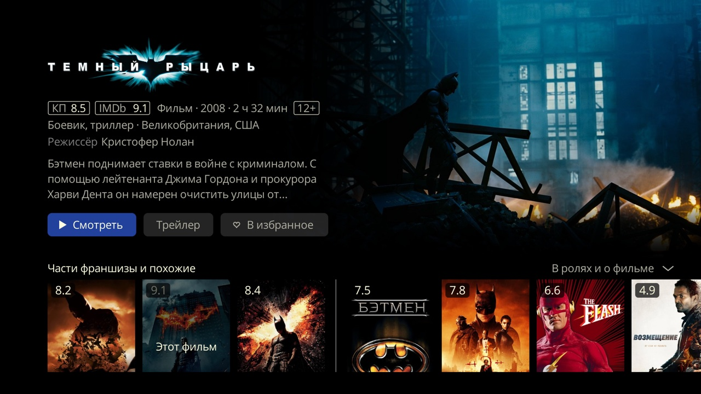
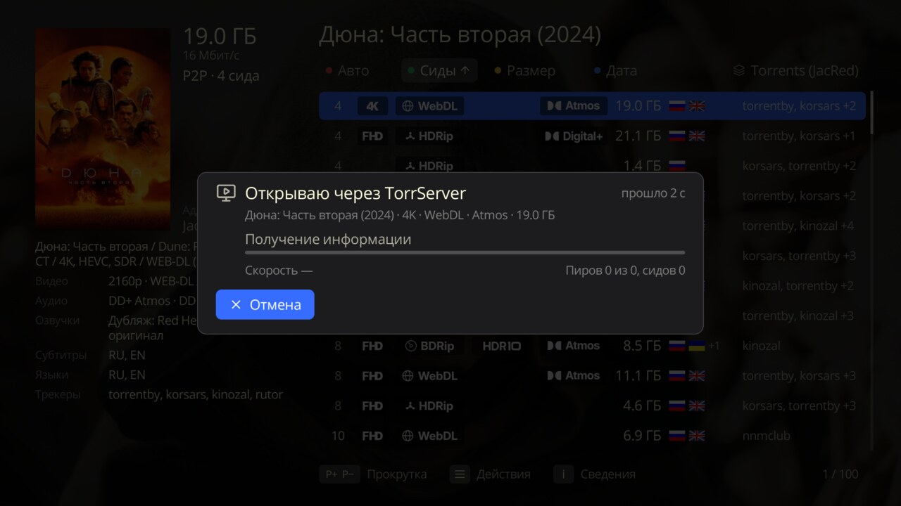
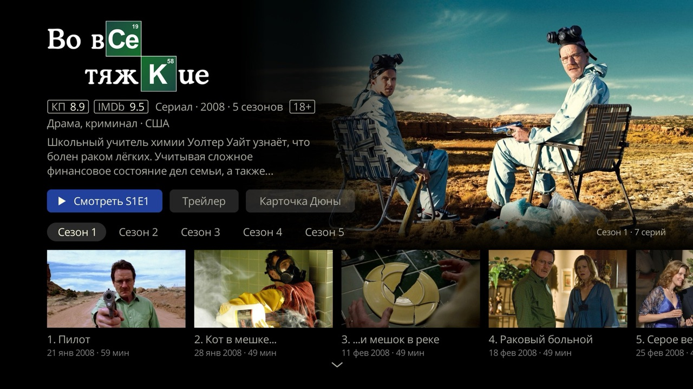
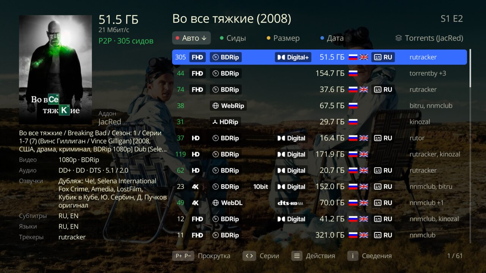
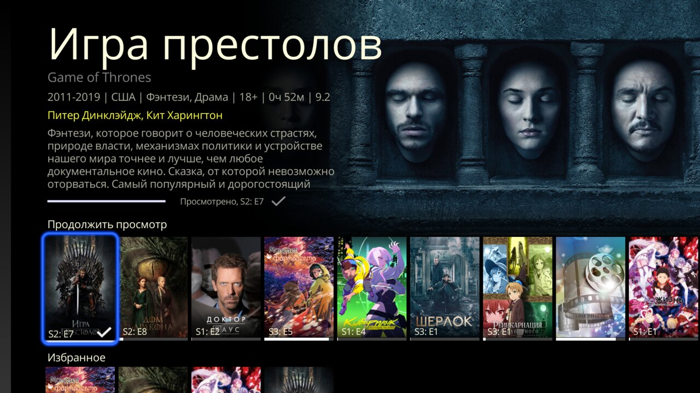
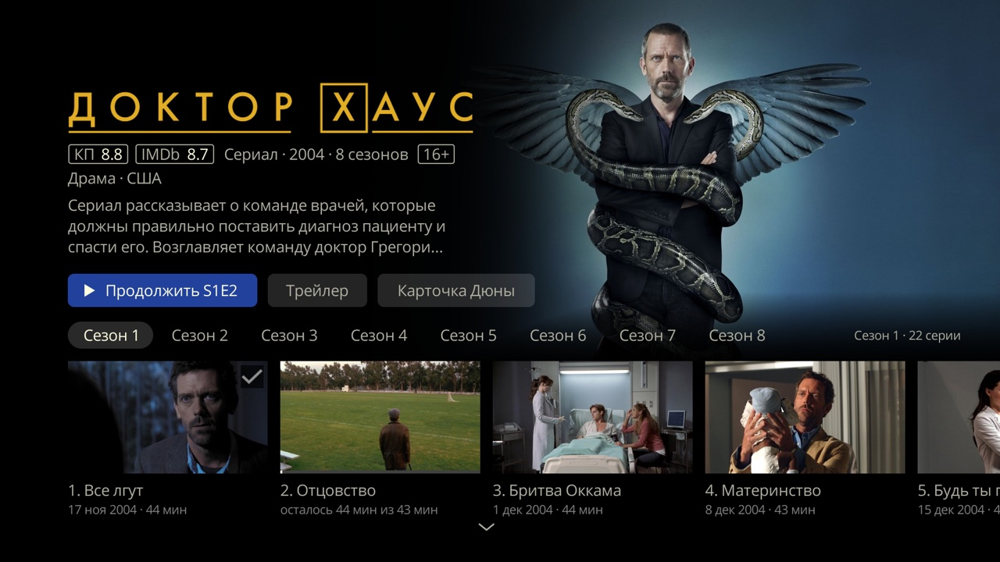
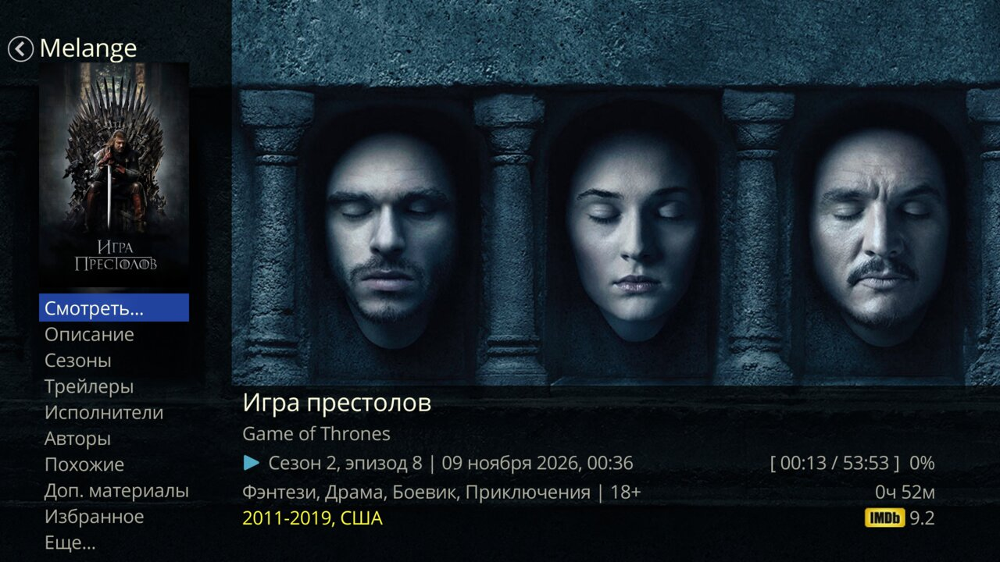
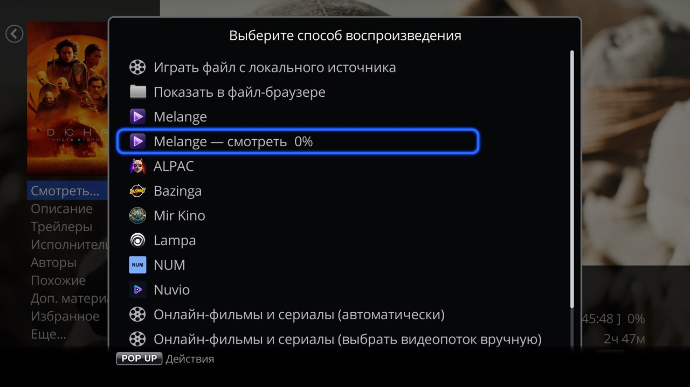
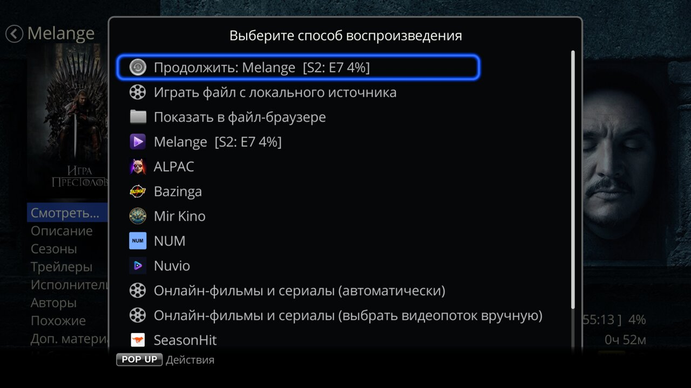

# Watching

Find and play a movie, then continue from the same spot. [← Contents](README.en.md)

## Movie

1. In the Melange catalog, choose the "Movies" or "Series" tab on the bar at the top.

   

2. Pick a movie in the rows or find it by title ([Search](search.en.md)).

3. Press **ENTER** on the poster. On the card, choose "Watch".

   

4. Choose a release and press **ENTER**. Releases are versions of the movie file: quality, voice-over, size. The more seeders (people sharing it, the number in the first column), the sooner the movie starts. The flags show dub languages. A "?" instead of a flag means the language is not confirmed (the card on the left shows it with a question mark: "RU?"). An "RU" label with a subtitles icon means the release has Russian subtitles.

   

5. Usually in about 10 seconds the "Opening via TorrServer" window gives way to the player.

   

   The peer and seeder numbers in the window go up. If nothing starts within a minute, choose a release with more seeders.

## Series

1. On the series card, choose a season and an episode.

   

2. Choose a release the same way as for a movie. Episodes then play one after another, and you can open the next or previous one right from the release list (buttons in the hint at the bottom). The frame shows a torrent list with seeders; with Debrid you see lightning bolts instead.

   

## Continue

1. What you started is in the first row of the Melange catalog, Continue Watching ([Continue Watching and Favorites](favorites.en.md)), and in the **Continue Watching** row on the Dune home screen. **ENTER** plays it from the same spot.

   

2. For a series, you can open its card in Melange and press "Continue" with the episode number.

   

## From the Dune Movies catalog

You can also open Melange from a card in the Dune **Movies** catalog: home screen → **Movies** → a movie.

1. On the movie or episode card, press **Play...**.

   

2. Choose "Melange".

   

3. To continue what you started, choose "Continue: Melange" in the same menu.

   

## If it didn't work

- "No file list within a minute: the release has few seeders": choose a release with more seeders.
- "TorrServer is not responding…": open TorrServe on the Dune ([Quick start](start.en.md#first-setup), step 1).
- "AIOStreams found no streams": the movie has no releases ([Troubleshooting](troubleshooting.en.md)).

Next: [Continue Watching and Favorites](favorites.en.md) · [Contents](README.en.md)
