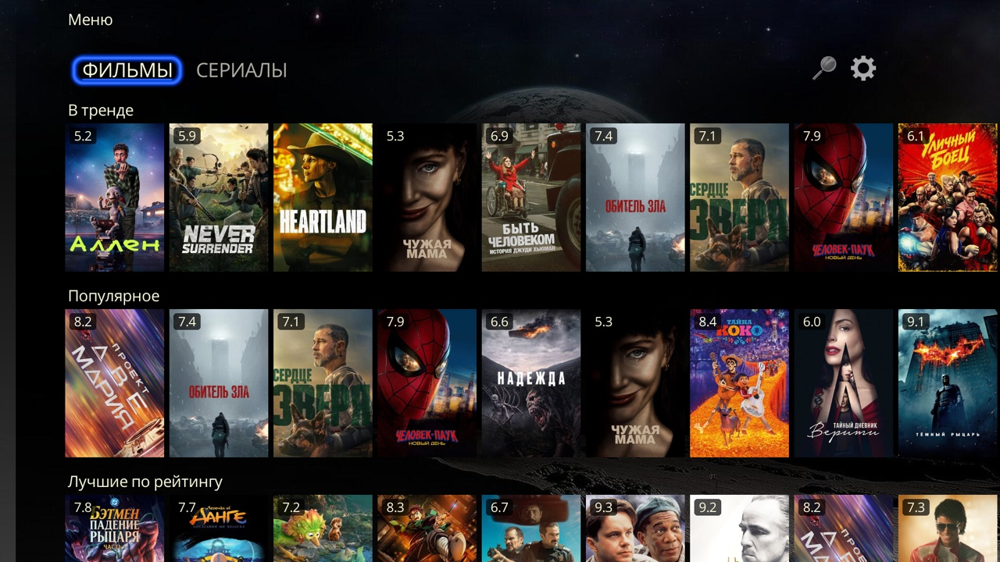
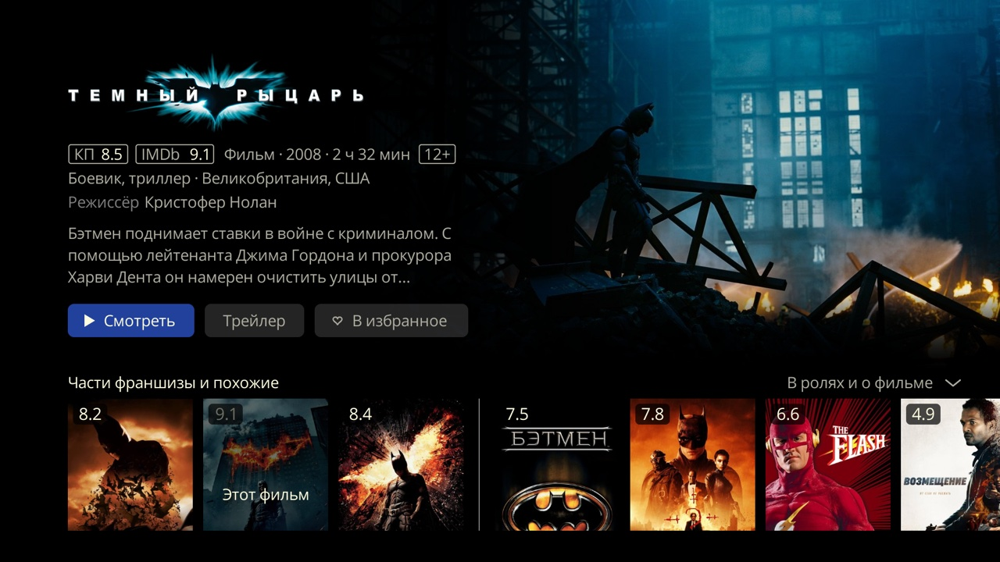
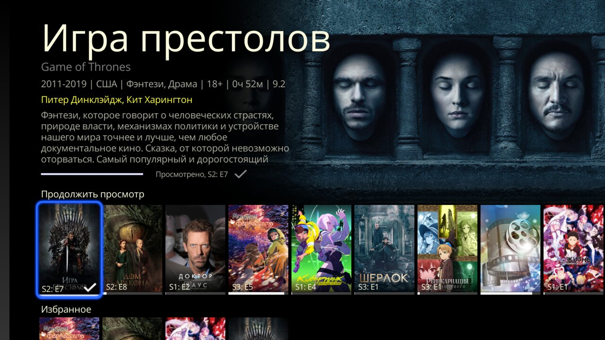
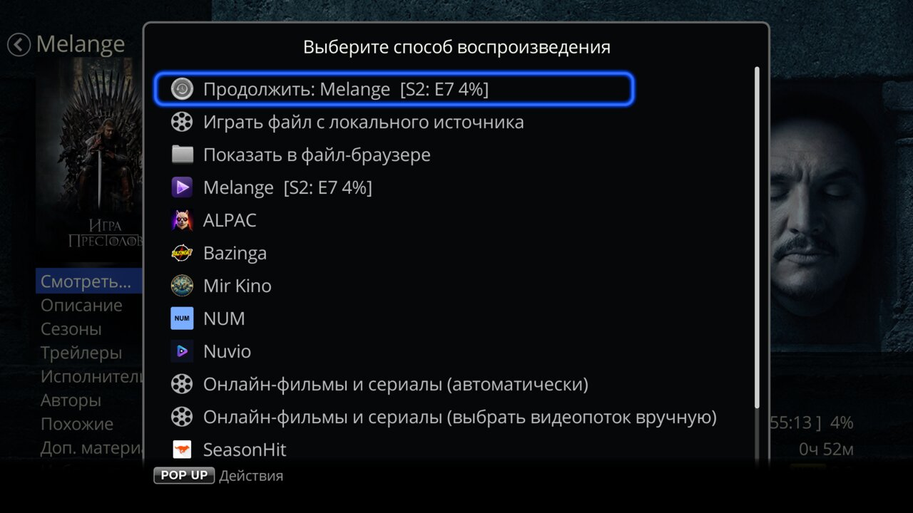

# Просмотр

Найдём и включим фильм, а потом продолжим с того же места. [← Оглавление](README.md)

## Фильм

1. В каталоге Melange выберите вкладку «Фильмы» или «Сериалы» на полосе сверху.

   

2. Чтобы найти фильм по названию, откройте поиск (лупа на той же полосе).

   

3. Нажмите **ENTER** на постере. В карточке выберите «Смотреть».

   

4. Выберите раздачу и нажмите **ENTER**. Раздачи — это варианты файла фильма: качество, озвучка, размер. Чем больше сидов (раздающих, число в первой колонке), тем быстрее начнётся фильм.

   

5. Через полминуты-минуту окно «Открываю через TorrServer» сменится плеером.

   

## Сериал

1. В карточке сериала выберите сезон и серию.

   

2. Раздачу выбирайте так же, как у фильма; следующие серии пойдут подряд. Соседнюю серию можно открыть прямо из списка: кнопки видны в подсказке внизу.

   

## Продолжить

1. Начатое — в ряду «Продолжить просмотр» на главном экране Дюны. **ENTER** включит его с того же места.

   

2. У сериала можно открыть его карточку в Melange и нажать «Продолжить» с номером серии.

   

## Из «Фильмов» Дюны

Melange можно открыть и из карточки в каталоге «Фильмы» Дюны.

1. В карточке фильма или серии нажмите «Смотреть…».

   

2. Выберите «Melange».

   

3. Начатое продолжается там же: пункт «Продолжить: Melange».

   

## Если не получилось

- «За минуту нет списка файлов: у раздачи мало сидов» — выберите раздачу с большим числом сидов.
- «TorrServer не отвечает…» — откройте TorrServe на Дюне ([Быстрый старт](start.md#первая-настройка), шаг 1).
- «AIOStreams не нашёл потоков» — у фильма нет раздач ([Решение проблем](troubleshooting.md#частые-ситуации)).

Дальше: настройки — в [оглавлении](README.md).
