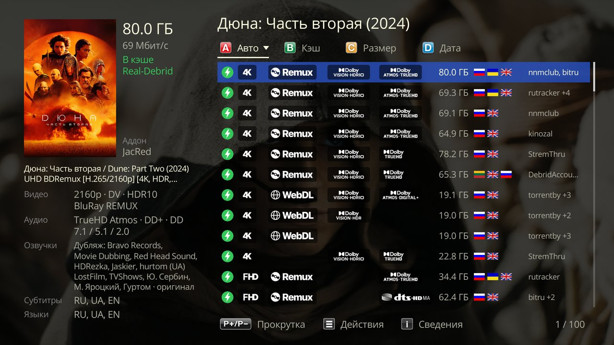
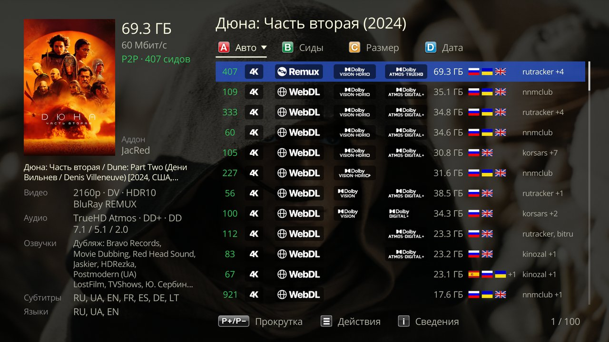
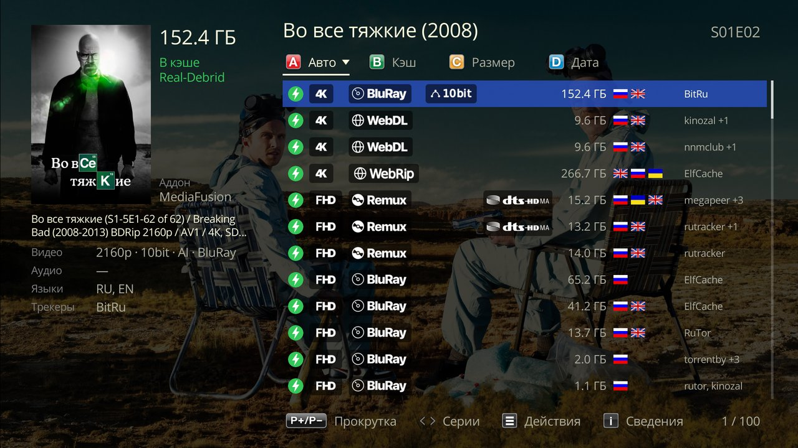
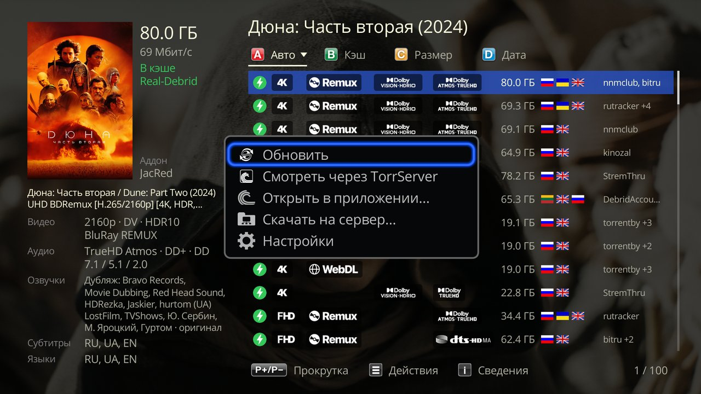
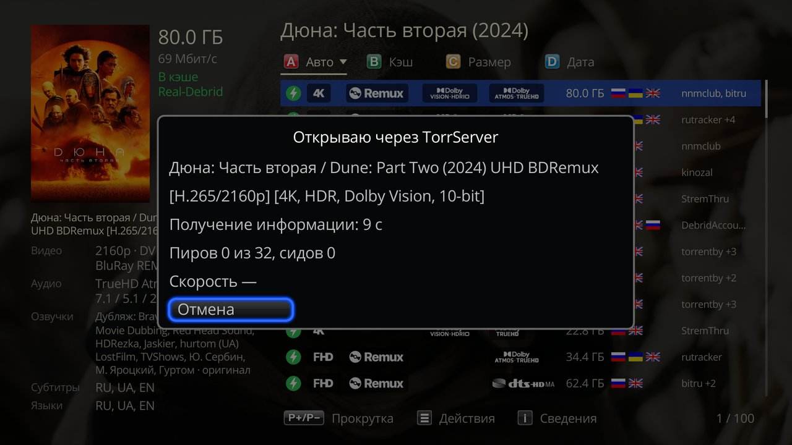
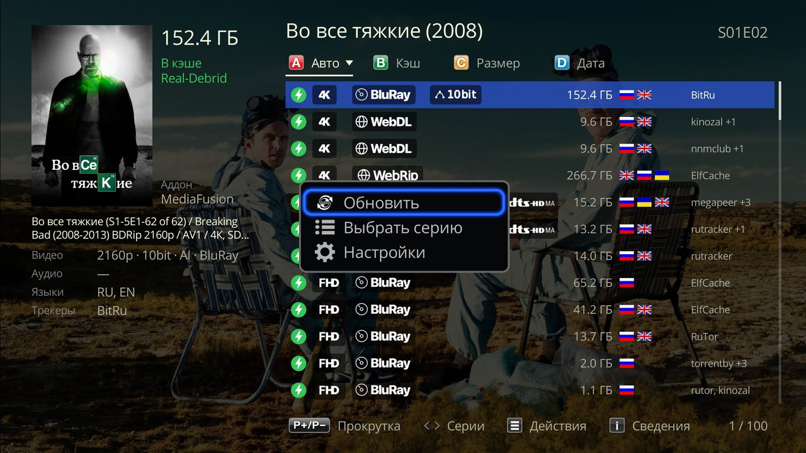

# Watching

How to open releases, what the list shows, series, TorrServer, history and the player. [← README](../README.en.md)

- [How to open](#how-to-open)
- [Release list](#release-list)
- [Keys](#keys)
- [The Actions menu](#the-actions-menu)
- [Watch via TorrServer](#watch-via-torrserver)
- [Open in an app](#open-in-an-app)
- [Download to server](#download-to-server)
- [Playing via Debrid](#playing-via-debrid)
- [Series: episode after episode](#series-episode-after-episode)
- [Skip Intro and Next Episode](#skip-intro-and-next-episode)
- [Continue Watching](#continue-watching)
- [In the player](#in-the-player)

## How to open

- **A movie:** its card in the Dune **Movies** catalog → **Play...** → **Melange**.
- **An episode:** on the series card, choose the episode via **Seasons**, then the same **Play...** → **Melange**.
- **A whole series:** **Melange** on the series card itself opens the episode where you stopped (or the next one if it is finished); with no history, the first episode.
- **From the Melange catalog:** see [Catalog](catalog.en.md#enter-on-a-poster).

## Release list

A release line has quality badges, size, languages and trackers; on the left are the details of the selected release: voice-overs, tracks and status.

| Status | What it means |
|---|---|
| **Cached in …** | the release is already in your Debrid and starts playing at once; **Cached in Real-Debrid · TorBox**: in the cache of both your services, one row |
| **Not cached** | it is not in the Debrid cache: Debrid may serve it at once, or may only start downloading it (see [Playing via Debrid](#playing-via-debrid)) |
| **unknown** | AIOStreams did not say whether the release is cached |
| **P2P · N seeders** | a release without Debrid, plays via TorrServer |

With Debrid, cached releases are marked with a lightning bolt (screenshot above); with **Torrents**, the first column shows the number of seeders:

### Sorting

The colored remote buttons: red keeps the AIOStreams order, green sorts by seeders (with Debrid, cached releases first), yellow by size, blue by date. Pressing again reverses the order; the chosen order is remembered.

## Keys

| Key | What it does |
|---|---|
| up / down, P+ / P− | through releases and pages |
| ENTER | play |
| INFO | release details: file, tracks, source; further with P+ / P−, everything AIOStreams sent (for troubleshooting) |
| ← / → (for an episode) | the list of the previous / next episode |
| MENU (≡, POP UP) | the **Actions** menu |

## The Actions menu

- **Refresh**: request the list again, for example if JacRed was slow to answer.
- **Watch via TorrServer**, **Open in an app…**, **Download to server…**: see the sections below; they are missing for a release without a torrent hash (not every source provides one) and with the [**No torrents**](setup.en.md#advanced) setting.
- **Source errors**: why sources sent no releases; present if turned on in the [settings](setup.en.md#advanced).
- **Main Debrid → TorBox** (or **→ Real-Debrid**): make the other service the main one, so releases cached in both play through it. Present if the list has such releases. It works at once and is the same setting as [on the page](sources.en.md#debrid).

## Watch via TorrServer

When you need it: to watch without Debrid, or a release that is not in the Debrid cache. P2P releases play this way on ENTER too. You need the TorrServe app on the Dune or your own TorrServer: see the [TorrServer settings](setup.en.md#torrserver).

While TorrServer looks for the files of the release, the screen shows peers, seeders and speed, so you can see whether it is downloading. Then the Dune player starts; for a series, with a playlist of the episodes in this release.

How long it takes to start depends on the seeders. Whether to forget the release after watching or keep it in the TorrServer list is set in the [TorrServer settings](setup.en.md#torrserver).

If it does not open, Melange shows the reason. If TorrServer does not answer or rejected the login, check it in the [TorrServer settings](setup.en.md#torrserver); if the file list did not arrive within a minute, the release has few seeders: choose another one.

## Open in an app

Opens the magnet link of the release in another app: Android offers every app that accepts magnets (a torrent client, qBitController / Transdroid for your own server, TorrServe). There is no episode playlist, history or **Continue Watching** then; **Watch via TorrServer** is there for those.

If several apps open magnets, do not choose **Always** in the Android dialog, or it will stop asking and always open the same one.

## Download to server

The item is there if at least one [own server](setup.en.md#download-to-your-server) is set on the settings page.

MENU → **Download to server…** → choose the server: Melange adds the release to the client with the category and tags, if set. Sending it again does not create a duplicate. After that, follow the download in the client itself. If the client did not accept the release, test the server with **Check** in the settings.

## Playing via Debrid

Before playing, Melange asks Debrid for a link to the file. If Debrid gives one, the movie plays with history, even if the release was **Not cached**. If the release is still downloading, a limit is reached or the release is blocked, Debrid serves a placeholder video instead of the movie; Melange recognizes it, does not start the player and shows the reason. The same if Debrid gives the release as one RAR or ZIP archive: the Dune cannot play it. If the release is downloading, try again later; otherwise choose another one.

If the release is cached in both of your services, the window shows which service refused and has a **Play via TorBox** (or **Play via Real-Debrid**) button: the same release starts through the other service. The next episodes of this viewing go through it too; next time, through the [main one](sources.en.md#debrid) again. If the second one refuses too, its reason is shown.

Start **Not cached** releases on Real-Debrid with care: see [Known limitations](limitations.en.md).

## Series: episode after episode

You can choose another episode without leaving the list: ← / → or MENU → **Choose episode** (if the series was opened from a Dune card).

- **Via Debrid** (a cached release, or the file link came at once), the player plays the whole season in order on this release, with P+ / P− and autoplay; at the end of the season, the first episode of the next one, if the release has it.
- **Via TorrServer**, the playlist has all episodes of all seasons in the release, starting from the selected one. If the episode numbers in the release cannot be recognized (absolute numbering, everything in one folder), the playlist is shorter: the current season and the first episode of the next.
- The next episode plays **the same way** the release was started, even if another way is available; after a **Play via …** button, through the service chosen.
- **The episode is not in the release:** Melange stops and offers to choose a release for this episode; it does not switch to another release by itself.
- **After Stop** on another episode, its list opens on the same release (except for episodes switched in the player via TorrServer).

## Skip Intro and Next Episode

At the start of an episode, the player offers to skip the intro or the recap, and at the credits to start the next episode right away (when the countdown ends, it starts by itself). The buttons are there if the AIOStreams server can provide intro and credits times (Melange's public server `aiostreams.kompotik.com` can), and only in the player of r25 firmware. If episodes take long to start, turn them off: **Advanced** → [**Skip intro and credits**](setup.en.md#advanced).

## Continue Watching

A movie or episode started on a cached release or via TorrServer shows up in the Dune's **Continue Watching** row, and the card button reads **Melange [NN%]**.

- **From Continue Watching**: straight to the same release from the same spot, the same way. If you watched the episode to the end, the next episode starts from the beginning, on the same release. If the release is no longer available, the list opens.
- **The Melange [NN%] button** opens the list with the cursor on the same release. Press ENTER, and the player offers to resume from the same spot. If you watched the episode to the end, the list of the next episode opens, the cursor on the same release too.
- When playback goes **without history**: see [Known limitations](limitations.en.md#watch-history).

## In the player

**INFO** opens the Dune panel: poster, title, the release (video, audio, size, voice-overs) and the description from the card. When watching via TorrServer, a TorrServer window at the top right also shows speed, peers and seeders, and how much is loaded.
