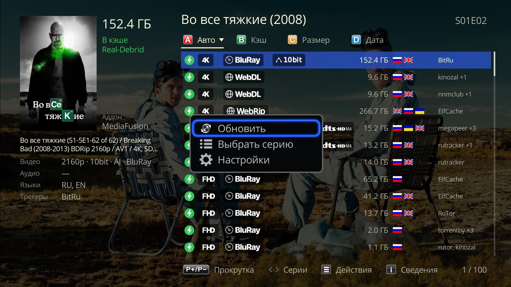

# Просмотр

Как открыть раздачи, что показывает список, сериалы, TorrServer, история и плеер. [← README](../README.md)

- [Как открыть](#как-открыть)
- [Список раздач](#список-раздач)
- [Клавиши](#клавиши)
- [Меню «Действия»](#меню-действия)
- [Смотреть через TorrServer](#смотреть-через-torrserver)
- [Открыть в приложении](#открыть-в-приложении)
- [Скачать на сервер](#скачать-на-сервер)
- [Запуск через Debrid](#запуск-через-debrid)
- [Сериалы: серии подряд](#сериалы-серии-подряд)
- [Пропустить заставку и Следующий эпизод](#пропустить-заставку-и-следующий-эпизод)
- [Продолжить просмотр](#продолжить-просмотр)
- [В плеере](#в-плеере)

## Как открыть

- **Фильм:** карточка в каталоге «Фильмы» Дюны → **«Смотреть…»** → **«Melange»**.
- **Серия:** в карточке сериала через **«Сезоны»** выберите серию и так же «Смотреть…» → «Melange».
- **Сериал целиком:** «Melange» в карточке сериала (не через «Сезоны») откроет список той серии, на которой вы остановились, а если она досмотрена — следующей. Без истории — первую серию первого сезона.
- **Из каталога Melange** — см. [Каталог](catalog.md#enter-на-постере).

Если конфига AIOStreams ещё нет, вместо списка — окно с кнопками «Быстрая настройка: торренты», «Настроить» и «Закрыть» (см. [Настройки](setup.md#как-открыть)).

## Список раздач

**Вверху** — название, у серии — сезон и серия; под названием — вкладки сортировки. **Внизу справа** — номер раздачи под курсором и число раздач («5 / 60»). На экране — до 100 раздач.

**В строке раздачи** — значки качества (разрешение, источник, HDR / Dolby Vision, звук), размер, флаги языков, трекеры.

**Слева** — подробности выбранной раздачи:

| Поле | Что значит |
|---|---|
| «В кэше Real-Debrid» (зелёным) | раздача уже лежит в вашем Debrid и начнёт играть сразу; название сервиса — по тому, что прислал AIOStreams |
| «Нужно скачать» (серым) | раздачи нет в кэше Debrid |
| «неизвестно» | AIOStreams не сообщил, в кэше ли раздача |
| «P2P» | раздача без Debrid, играет через TorrServer |
| «Озвучки» | «Дубляж: <студии>», затем остальные студии |
| «Видео», «Аудио», «Субтитры», «Языки», «Трекеры» | дорожки и источник раздачи |

Озвучки Melange определяет по названию раздачи и её дорожкам, дорожки и озвучки берёт ещё и из JacRed.

### Сортировка

Цветные кнопки пульта меняют порядок; выбранный — ярче, треугольник показывает направление. Повторное нажатие той же кнопки — обратный порядок. Выбранный порядок запоминается.

| Кнопка | Порядок |
|---|---|
| красная — «Авто» | как прислал AIOStreams |
| зелёная — «Сиды» | больше сидов — выше; в списке с Debrid вкладка называется «Кэш»: раздачи в кэше — сверху |
| жёлтая — «Размер» | больше — выше |
| синяя — «Дата» | новее — выше |

Раздачи без значения (нет сидов, размера или даты) — в конце.

## Клавиши

| Клавиша | Что делает |
|---|---|
| вверх / вниз | по раздачам |
| P+ / P− | на страницу («Прокрутка») |
| ENTER | смотреть |
| INFO | «Сведения о раздаче» |
| ← / → (у серии) | список предыдущей / следующей серии |
| цветные кнопки | сортировка |
| MENU (≡, POP UP) | «Действия» |

**INFO — «Сведения о раздаче».** На первой странице — главное о файле, дорожках и источнике. P+ / P− — следующие страницы со всем, что прислал AIOStreams и вычислил Melange (для разбора ошибок).

**← / → — «Серии».** Открывает список соседней серии; курсор встанет на ту же раздачу, если она там есть. «Назад» из пролистанной серии — сразу в карточку.

## Меню «Действия»

MENU (≡, POP UP; внизу экрана — «Действия»):

| Пункт | Когда есть | Что делает |
|---|---|---|
| **«Обновить»** | всегда | запросить список у AIOStreams заново — например, если JacRed ответил не сразу. Курсор останется на той же раздаче; не вышло — окно «Список не обновился» с причиной, список прежний |
| **«Выбрать серию»** | у серии | экран «Сезоны» Дюны: выбранная серия откроет свой список раздач (не вышло — «Серия … не загрузилась») |
| **«Смотреть через TorrServer»** | у раздачи с хэшем | [открыть через TorrServer](#смотреть-через-torrserver), а не через Debrid |
| **«Открыть в приложении…»** | у раздачи с хэшем | [magnet-ссылка в другом приложении](#открыть-в-приложении) |
| **«Скачать на сервер…»** | у раздачи с хэшем, если задан сервер | [отправить в свой торрент-клиент](#скачать-на-сервер) |
| **«Ошибки источников»** | если включены в настройках | причины, по которым источники не прислали раздачи |
| **«Настройки»** | всегда | экран настроек Melange |

При настройке «Без торрентов» («Дополнительно») пунктов «Смотреть через TorrServer», «Открыть в приложении…» и «Скачать на сервер…» нет.

## Смотреть через TorrServer

Когда нужно: смотреть без Debrid или раздачу, которой нет в кэше Debrid. Раздачи P2P так играют и по ENTER.

1. Пока TorrServer ищет список файлов, открыто окно «Открываю через TorrServer»: что делает TorrServer («Получение информации», «Предзагрузка»…), секунды, пиры и подключённые сиды, скорость загрузки, кнопка «Отмена».
2. Потом запускается встроенный плеер. У сериала все серии из той же раздачи — в плейлисте плеера (см. [серии подряд](#сериалы-серии-подряд)).

<!-- скриншот: screenshots/torrserver-open.jpg — окно «Открываю через TorrServer» на Дюне: стадия («Предзагрузка»), секунды, пиры и сиды, скорость, кнопка «Отмена» -->

Скорость и время до начала зависят от сидов раздачи. Что делать с раздачей после просмотра (забыть или оставить в списке TorrServer), задаётся в [настройках TorrServer](setup.md#torrserver).

Если не вышло — окно «Не открылось через TorrServer» с причиной:
- TorrServer не отвечает — установите и запустите приложение TorrServe;
- просит логин и пароль или не принял их — задайте их в настройках Melange → TorrServer;
- не принял раздачу;
- за минуту не пришёл список файлов — мало сидов;
- в раздаче нет файла этой серии.

## Открыть в приложении

**«Открыть в приложении…»** открывает magnet-ссылку раздачи в приложении на выбор: Android покажет все установленные приложения, которые принимают magnet (торрент-клиент, qBitController / Transdroid для своего сервера, TorrServe). TorrServe предлагает «Играть», «Доб. и играть» и «Добавить» — так раздача попадает в его список.

Отличие от «Смотреть через TorrServer»: тот открывает плеер Дюны с плейлистом серий, «Продолжить просмотр» и следующей серией, через приложение этого нет.

Не выбирайте в окне Android «Всегда», если magnet открывают несколько приложений.

## Скачать на сервер

Пункт есть, если на странице настроек задан хотя бы один сервер ([Скачивать на свой сервер](setup.md#скачивать-на-свой-сервер)).

1. MENU → **«Скачать на сервер…»** — список серверов. Курсор — на сервере с сервисом, в кэше которого раздача, иначе на первом «Не из кэша».
2. ENTER — Melange сам добавит magnet-ссылку в клиент (с категорией и тегами, если заданы) и покажет «Добавлено в <сервер>».

Повторный ENTER снова отправит раздачу на сервер (например, если её удалили в клиенте). Дважды клиент её не добавит: qBittorrent не примет, rdt-client оставит ту, что уже есть, Transmission ответит «Уже есть в <сервер>».

Если не вышло — «Не добавлено в <сервер>» с причиной: нет связи с сервером, неверный логин или пароль, клиент не принял раздачу (может быть, она там уже есть).

## Запуск через Debrid

Перед запуском Melange один раз спрашивает у Debrid ссылку раздачи.

- Debrid отдал ссылку на файл — фильм играет с историей, даже если раздача была помечена «Нужно скачать».
- Debrid отдал вместо фильма видео-заглушку (раздача ещё качается, лимит, ошибка) — плеер не запускается, прогресс фильма в истории не портится. Melange показывает одно из сообщений:

| Сообщение | Что значит |
|---|---|
| «Debrid ещё не скачал раздачу, попробуйте позже» | раздача качается в Debrid |
| «Лимит Debrid» | исчерпан лимит сервиса |
| «Debrid заблокировал раздачу: авторские права» | раздача недоступна в Debrid |
| «Debrid вернул заглушку» | с именем файла; у Comet — с размером ролика, причину Comet не сообщает |

У следующей серии в плеере в таком случае — окно «Серия … не загрузилась» с кнопкой «Стоп».

Раздачи «Нужно скачать» у Real-Debrid стоит запускать осторожно — см. [Известные ограничения](limitations.md).

## Сериалы: серии подряд

**Через Debrid.** Если раздача в кэше или Debrid сразу отдал ссылку на файл, плеер играет весь сезон по порядку на этой же раздаче (P+ / P− и автопереход). В конце сезона — первую серию следующего, если она есть в той же раздаче.

**Через TorrServer.** В плейлисте — все серии всех сезонов, которые есть в раздаче, старт — с выбранной. Сезон файла Melange берёт из имени (`S02E03`) или из папки (`S2`, `Season 2`, `2 сезон`). Если сезон или номер файла не подтверждаются (сквозная нумерация, всё в одной папке), в плейлисте — текущий сезон и первая серия следующего: лучше короткий список, чем чужая серия. Больше 500 серий — только текущий сезон.

**Способ не смешивается.** Следующая серия идёт тем же способом, каким включили раздачу: через TorrServer — даже если раздача есть в кэше Debrid; через Debrid — даже если TorrServer запущен.

**Если серии нет.** Окно «Серии S01E05 нет в этой раздаче» с кнопками **«Выбрать раздачу»** (список этой серии) и **«Стоп»**. Переключиться на другую раздачу сам Melange не пытается.

**Что спрашивается на переходе.** Следующая серия через TorrServer не спрашивает AIOStreams, только TorrServer; раздача, где файл серии не определить, — один запрос к AIOStreams на переход. Копия и качество на переходах не меняются.

**После STOP.** Если остановиться на другой серии, чем в списке, откроется список этой серии (один запрос к AIOStreams), курсор — на той же раздаче. Не ответил AIOStreams — останется прежний экран. Исключение: после серии, переключённой в плеере через TorrServer (P+ / автопереход), список раздач по «Стоп» остаётся на первой серии.

## Пропустить заставку и Следующий эпизод

- В начале серии плеер показывает кнопку **«Пропустить заставку»**: ENTER — к концу заставки или пересказа прошлых серий.
- На титрах — **«Следующий эпизод»** с отсчётом: по нулю сам включает следующую серию.

Время заставки и титров Melange спрашивает у сервера AIOStreams, с которого пришли раздачи, — если сервер это умеет (публичный сервер Melange `aiostreams.kompotik.com`). На других серверах серии играют без кнопок. Кнопки показывает плеер прошивки r25.

Если серии долго запускаются, выключите кнопки: «Дополнительно» → [«Пропуск заставки и титров»](setup.md#дополнительно).

## Продолжить просмотр

Фильм или серия, начатые на раздаче **в кэше** или через TorrServer, появляются в ряду «Продолжить просмотр» Дюны, а на кнопке в карточке — «Melange [NN%]».

- **Из «Продолжить просмотр»** — сразу та же раздача с того же места, без списка, тем же способом, каким её включили: через Debrid — если она в кэше или Debrid сразу отдаёт ссылку на файл; через TorrServer — если он отвечает. Иначе, а также если AIOStreams её больше не присылает, откроется список.
- **Кнопка «Melange [NN%]»** в карточке открывает список. Выберите ту же раздачу — плеер сам предложит «Продолжить воспроизведение» или «С начала».
- **Без истории** играют раздачи не в кэше и с неизвестным статусом, если Debrid не отдал сразу ссылку на файл, и фильмы из каталога Melange без карточки Дюны — подробнее в [Известных ограничениях](limitations.md).

## В плеере

**INFO** — панель Дюны: постер, название, имя раздачи, строка о ней (видео, звук, размер, озвучки) и описание фильма или сериала из карточки. У сериала с плейлистом сезона название — один раз, серия — «S01E02».

При просмотре через TorrServer INFO показывает рядом со штатным окном, справа вверху, окно TorrServer: раздача, скорость загрузки и отдачи, пиры и сиды, сколько загружено. Обновляется раз в секунду, закрывается вместе с INFO.
